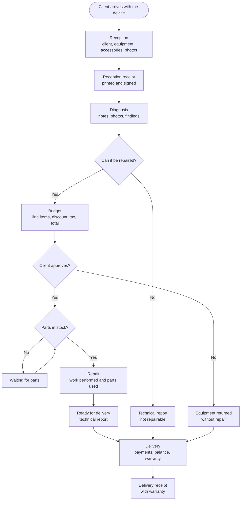
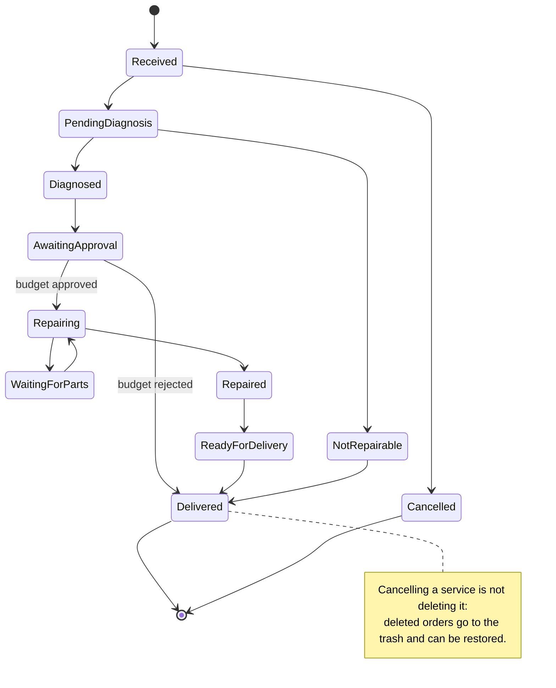
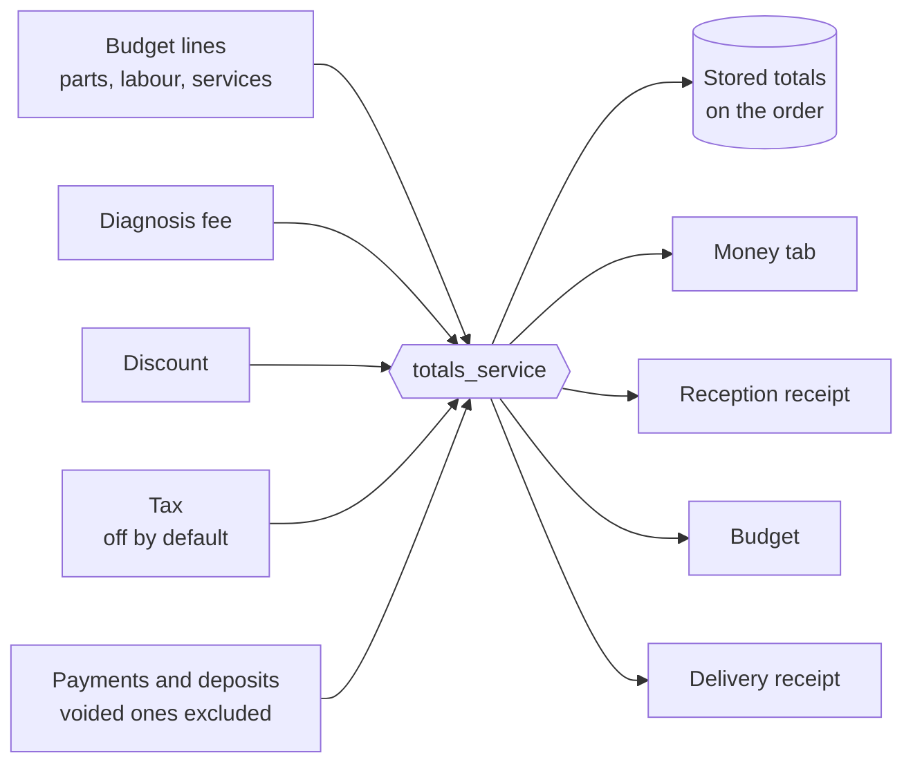
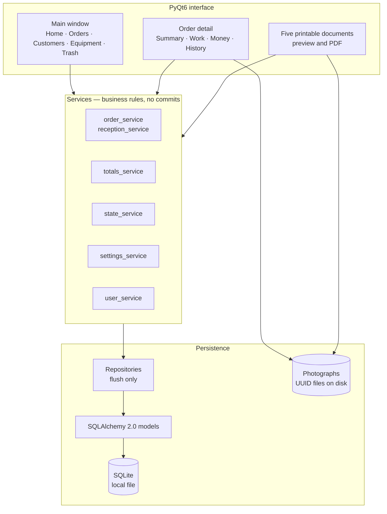
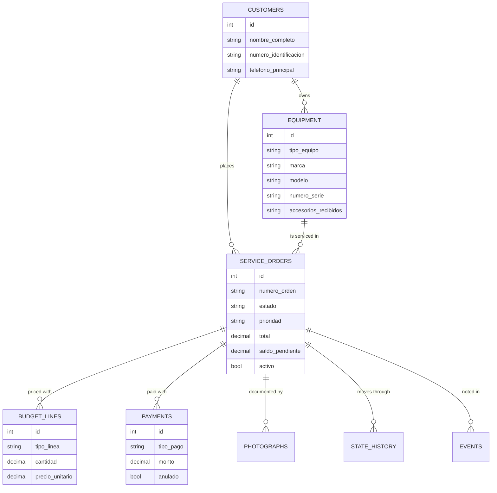
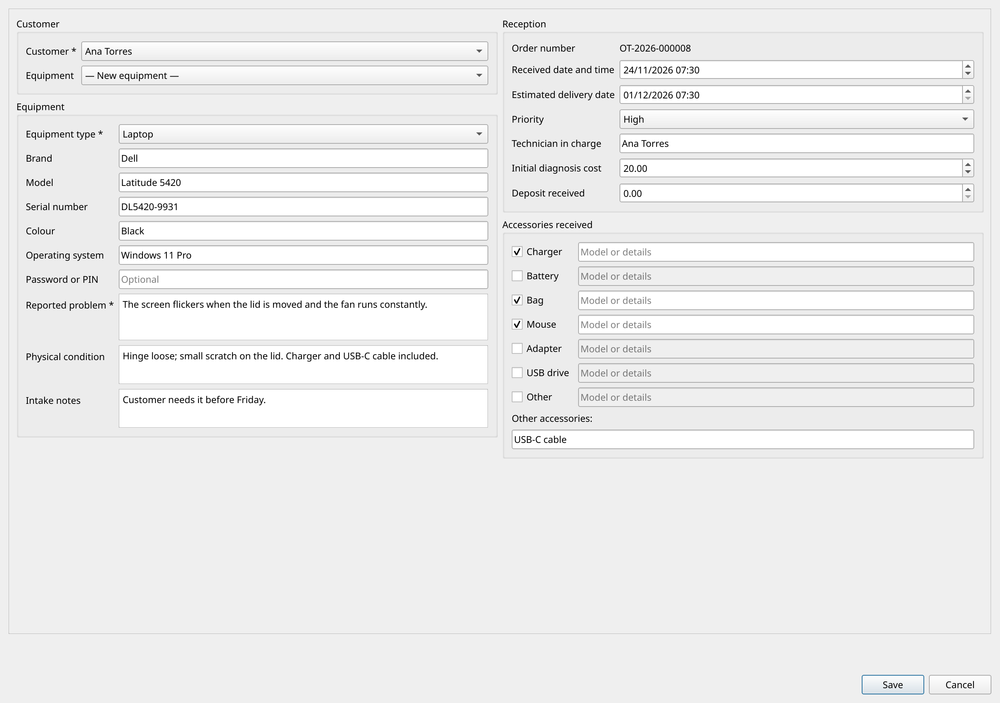
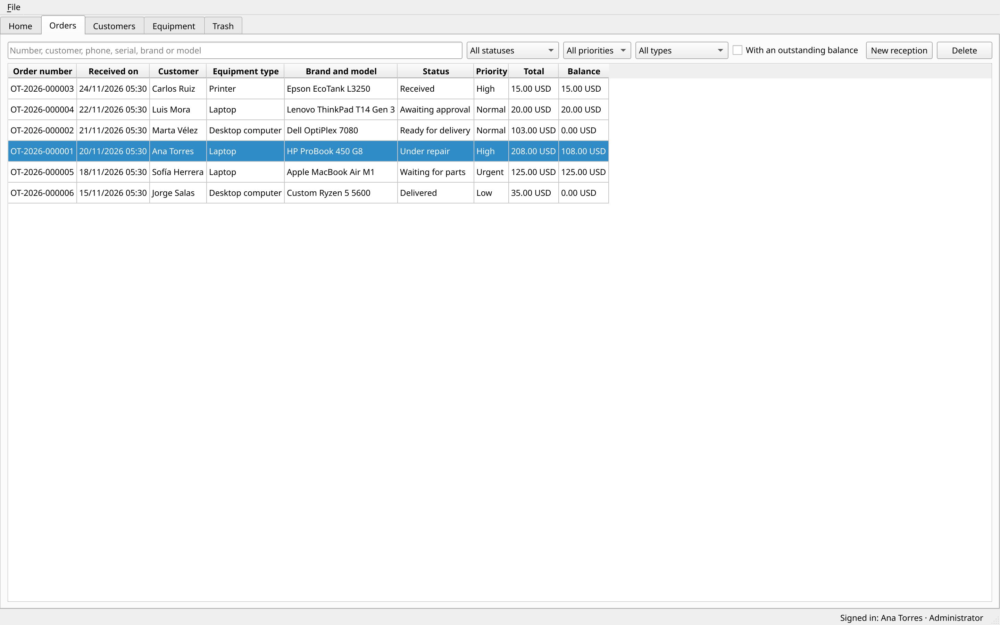
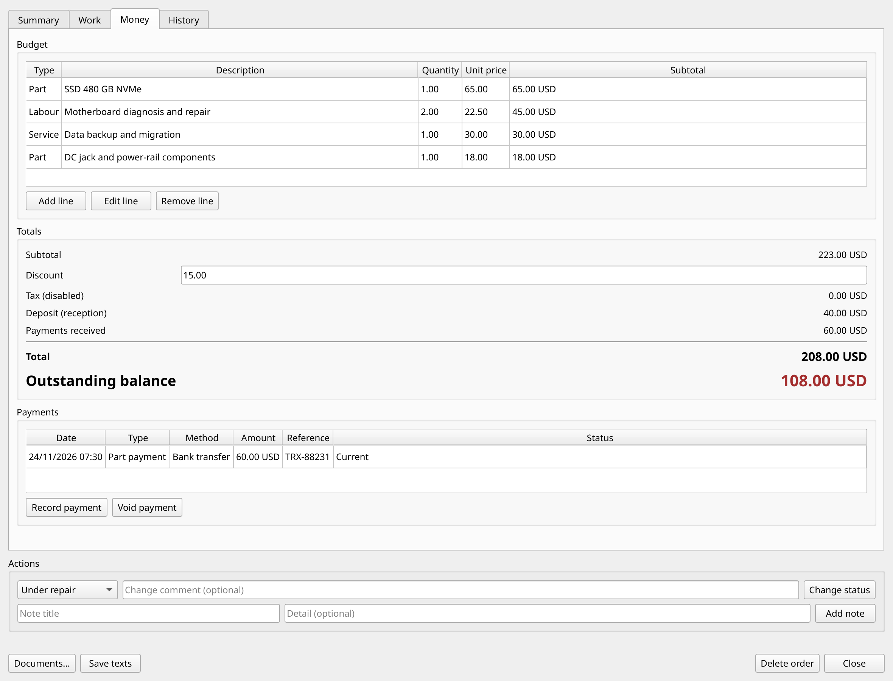
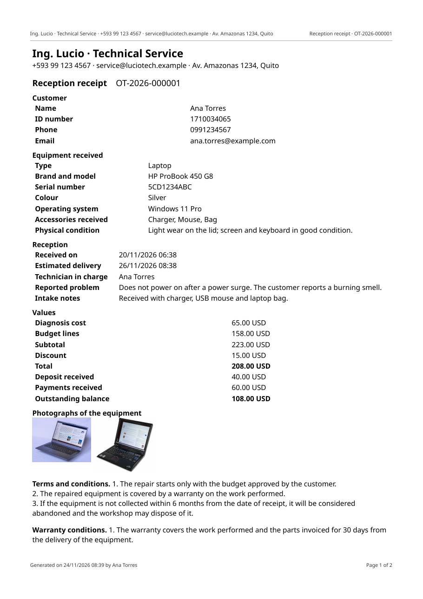

# LucioTech Service Manager

<p align="center">
  <strong>Offline desktop management for a repair workshop</strong><br/>
  Reception → diagnosis → budget → repair → delivery, with the paperwork ready to print.
</p>

<p align="center">
  <a href="LICENSE"></a>
  
  
  
  
  
  
  
  
</p>

**English** · [🇪🇸 Leer en español](README_ES.md)

A desktop application written in Python 3 and PyQt6 to record the intake, diagnosis, repair and delivery of electronic equipment at the technical service of **Ing. Lucio**. It works fully offline: the database, the photographs and the printed documents never leave the computer.

This README is written for two readers at once. If you repair equipment, start with [Why a technician would use it](#why-a-technician-would-use-it) and [How it works](#how-it-works); if you are a developer, the [Project structure](#project-structure) and [Testing](#testing) sections will get you productive.

> **Status:** Phase 1 (runnable core), Phase 2 (diagnosis, predefined texts and photographs) and Phase 3 (budgets, payments, PDF and printing) are closed. Phase 3 delivered the budget line items and the **Dinero** tab, the trash with restore, the five documents of §13.1 (reception receipt, budget, technical report, delivery receipt and full history) with page numbers, header and footer, A4/Letter paper, configurable margins and PDF export with a descriptive file name, the order detail in four tabs, user accounts with password login and the **Configuración** screen for workshop data, taxes, terms and conditions and the warranty. Phase 4 (reports, backups, themes and packaging) is next and has not started yet; the multilingual interface of §21 is already in place. See [`ROADMAP.md`](ROADMAP.md) for details.

## Why a technician would use it

- **One order per device, from the counter to the delivery.** The order keeps the client, the equipment, the reported problem, the diagnosis, the photographs, the budget, every payment and the whole history in one place. Nothing lives in a notebook, a spreadsheet and a folder at the same time.
- **The paperwork is part of the flow, not a separate job.** The five documents of the workshop — reception receipt, budget, technical report, delivery receipt and full history — are generated from the same data you already typed, with the workshop header, page numbers and the legal terms you configured.
- **The money has one formula.** Budget lines, diagnosis fee, discount, tax, deposits, payments and balance are calculated in a single place, so the screen, the receipt, the budget and the delivery note never disagree.
- **It works with no internet and no account.** A SQLite file holds everything; the program does not phone home. That matters in a workshop with a flaky connection and for client data that should stay on the bench.
- **Each technician signs their own work.** Accounts with roles, a session name in the status bar, and that name printed in the history and the footer of every document.
- **Nothing is thrown away.** Deleting an order is logical: it moves to the trash and can be restored. Payments are voided, not erased, and every status change is kept.

## How it works

The diagrams below are the shortest path to understanding the program. All of them render natively on GitHub.

### A day at the workshop

What the technician does, and which document comes out of each step.



### The life of an order

The states the order goes through. They match the status selector and the **Next step** button in the order window; today any status can be set from any other, because the transition rules are still pending.



### One source of truth for the money

Every amount on screen and on paper is produced by the same totals formula (§5.3). This is why a payment voided in the **Money** tab also disappears from the delivery receipt.



### Inside the application

The interface never writes SQL: it calls services, services use repositories, repositories use SQLAlchemy, and SQLAlchemy talks to the local SQLite file.



### The data model

The tables that matter on a normal day. `state_history` and `events` are the order's audit trail; `usuarios` is not linked by foreign key because the history keeps the name of whoever signed each change.



## Screenshots

All of them come from the demonstration data that `tools/capture-screenshots.py` builds; none of it belongs to a real workshop.

| Reception | Orders |
| --- | --- |
|  |  |
| Client, equipment, accessories and deposit in a single pass. | Search, filters and the balance of every order. |

| Money | Reception receipt |
| --- | --- |
|  |  |
| Budget lines, payments and balance, from the same formula as the paper. | What the client signs, with the terms and the warranty. |

## Contents

- [Why a technician would use it](#why-a-technician-would-use-it)
- [How it works](#how-it-works)
- [Screenshots](#screenshots)
- [Requirements](#requirements)
- [Installation on Linux](#installation-on-linux)
- [Installation on Windows](#installation-on-windows)
- [Running the application](#running-the-application)
- [Languages](#languages)
- [Trying the interface](#trying-the-interface)
- [Reception receipt and terms and conditions](#reception-receipt-and-terms-and-conditions)
- [Settings and editable legal texts](#settings-and-editable-legal-texts)
- [Testing](#testing)
- [Project structure](#project-structure)
- [Data location](#data-location)
- [Password storage policy](#password-storage-policy)
- [Users and access](#users-and-access)
- [Troubleshooting](#troubleshooting)
- [License](#license)

## Requirements

- Windows 10 or 11 (64-bit) is supported. The code branches on the platform and stores its data under `%APPDATA%` / `%LOCALAPPDATA%` on Windows.
- Linux (Debian, Ubuntu, MX Linux or a derivative) is the primary target platform.
- Python 3.11 or newer (64-bit). On Windows, Python 3.12 or 3.13 is recommended.
- No additional system packages are needed on Windows: PyQt6 ships its own Qt runtime through the `PyQt6-Qt6` wheel.

### Install Python on Windows

1. Download the installer from <https://www.python.org/downloads/windows/>.
2. During setup, tick **Add python.exe to PATH** and **Install the py launcher**.
3. Verify it in a terminal:

   ```bat
   py -3.13 --version
   ```

   You should see something like `Python 3.13.x`. If `py` is not found, reinstall Python with the launcher option enabled.

## Installation on Linux

Linux (Debian, Ubuntu, MX Linux or a derivative) is the primary target platform. Run these commands in a terminal from the project folder. There are two ways to install it: the distribution packages (Option A, no virtual environment) or a virtual environment with `pip` (Option B).

### 1. System libraries for Qt 6

PyQt6 brings its own Qt runtime inside the wheel, but the `xcb` platform plugin still needs a few system libraries. On Debian, Ubuntu or MX Linux:

```bash
sudo apt install libxcb-cursor0 libxkbcommon-x11-0 libegl1 libgl1
```

`libxcb-cursor0` is the one missing most often: without it the application stops with `Could not load the Qt platform plugin "xcb"` even though PyQt6 imported fine.

### 2. Option A — distribution packages (no virtual environment)

Debian 13 (trixie), Ubuntu 25.04 and newer ship the four dependencies as distribution packages. Install them with `apt`:

```bash
sudo apt install python3-pyqt6 python3-sqlalchemy python3-alembic python3-reportlab qt6-translations-l10n
```

`qt6-translations-l10n` is optional: it brings the Spanish texts of Qt's own dialogs (print preview, file dialogs and warnings). Then start the program from the project folder:

```bash
PYTHONPATH=src python3 -m luciotech.main
```

No virtual environment, no activation and nothing installed with `pip`: `PYTHONPATH` points that single command at `src/`, and the modules come from the packages in `/usr/lib/python3/dist-packages`, so `sudo apt upgrade` keeps the application up to date together with the rest of the system.

The application needs **SQLAlchemy 2.0 or newer**. Debian 13 and Ubuntu 25.04 or newer ship 2.0.x, but Debian 12 (bookworm) and Ubuntu 24.04 LTS still ship 1.4.50, where the application does not start. Check it with:

```bash
python3 -c "import sqlalchemy; print(sqlalchemy.__version__)"
```

If the answer starts with `1.4`, use Option B.

### 3. Option B — virtual environment

You only need to do this the first time:

```bash
python3 -m venv .venv
.venv/bin/python -m pip install --upgrade pip
.venv/bin/python -m pip install -r requirements.txt
```

Calling `.venv/bin/python` directly takes the place of activating the environment, so there is no `source` command to get wrong. `PyQt6` is around 75 MB, so this step may take a few minutes.

### 4. Run it with the virtual environment

```bash
./run.sh
```

`run.sh` uses the `.venv` interpreter, points `PYTHONPATH` at `src/` for that command only and starts the application, so nothing has to be installed into the environment beyond the requirements. The equivalent one-liner is:

```bash
PYTHONPATH=src .venv/bin/python -m luciotech.main
```

If git did not keep the executable bit, run `chmod +x run.sh` once. To get the `luciotech-service-manager` command instead, install the package itself in editable mode once: `.venv/bin/python -m pip install -e .`.

## Installation on Windows

The commands below work in **PowerShell**, **cmd.exe** and **Git Bash**. Run them from the project folder.

### 1. Create the virtual environment (the `.venv` folder is created inside the project):

   ```bat
   py -3.13 -m venv .venv
   ```

### 2. Activate it. Pick the command for your shell:

You will need to perform this step the next time you want to run the program from its source code:

Choose one:

**:: PowerShell**

```bat
.\.venv\Scripts\Activate.ps1
```

**:: cmd**

```bat
.venv\Scripts\activate.bat
```

**:: Git Bash**

```bat
source .venv/Scripts/activate
```

#### 2.2 After activation the prompt shows `(.venv)`.

   > **PowerShell note:** if activation fails with "running scripts is disabled on this system", allow scripts for the current user once:
   >
   > ```powershell
   > Set-ExecutionPolicy -Scope CurrentUser -ExecutionPolicy RemoteSigned
   > ```
   >
   > Alternatively, skip activation entirely and call the interpreter by its path: `.venv\Scripts\python.exe -m pip ...`.

### 3. Install the dependencies:

You only need to do this the first time:

```bat
python -m pip install --upgrade pip
python -m pip install -r requirements.txt
```

`PyQt6` is around 75 MB, so this step may take a few minutes.

### 4. Install the package itself (creates the `luciotech-service-manager` command):

You only need to do this the first time:

```bat
python -m pip install -e .
```

## Running the application

You will need to perform this step the next time you want to run the program from its source code:

With the virtual environment activated, from the project folder:

```bat
python -m luciotech.main
```

On Linux, `./run.sh` from the project folder does the same without activating anything. With the distribution packages of Option A there is no `.venv` to use: `PYTHONPATH=src python3 -m luciotech.main`, as shown in [Installation on Linux](#installation-on-linux).

> **Installed vs. run-without-installing — will my edits show up?**
> Both paths start the program straight from the `src/` folder on disk, so any change you save in the code is picked up the next time you launch. Nothing is copied or frozen.
> - **Activated + `pip install -e .`** (the steps above): the editable install registers a live link between the `luciotech` package and `src/`, and puts the `.venv` interpreter (with all the dependencies) first on your `PATH`. After that you can just run `python -m luciotech.main` from any prompt, with no `PYTHONPATH` needed.
> - **`PYTHONPATH=src`** (below): points the current `python` at `src/` for that one command only. No link is registered and nothing is written, so you must repeat `PYTHONPATH=src` every time you launch. Good for a quick one-off run, but the Python you use still has to have the dependencies — normally the `.venv` one.

## Languages

The program is written in English and ships with a Spanish translation; the language can be changed at **File ▸ Settings ▸ Language**. The change is saved in the database and takes effect the next time the application starts. If no catalogue exists for the chosen language, the program shows its English source texts.

The default texts that ship with the program also follow the chosen language: the equipment types, the predefined phrases and the terms and warranty conditions. Equipment types, accessories and the generated history notes are stored with their original value and translated only on screen, so existing orders, custom types and the accessories suggestion keep working when the language changes.

Translations use the standard Qt workflow:

| File | Purpose |
| ---- | ------- |
| `translations/luciotech_es.ts` | Editable catalogue, opened and reviewed in **Qt Linguist** |
| `src/luciotech/ui/translations/luciotech_es.qm` | Compiled catalogue the application loads at startup |
| `tools/update-translations.sh` | Runs `pylupdate6` and `lrelease` for every `.ts` |

To add a language:

1. Create the catalogue with `pylupdate6` (or copy an existing `.ts` and translate it in Qt Linguist):

   ```bash
   .venv/bin/pylupdate6 $(find src/luciotech -name '*.py') -ts translations/luciotech_fr.ts
   ```

2. Translate the messages in **Qt Linguist** (`linguist translations/luciotech_fr.ts`) and save.
3. Compile it into the package folder:

   ```bash
   lrelease translations/luciotech_fr.ts -qm src/luciotech/ui/translations/luciotech_fr.qm
   ```

4. Reopen the program: the new language appears in the Settings list. The `.qm` file has to travel with the application.

Any language that is added this way is listed automatically; `ui/translations.py` only carries the native names used for the common ones. `lrelease` comes from the Qt tools (`qt6-linguist-tools` on Debian/Ubuntu), and `pylupdate6` is included with PyQt6.

## To run without installing the package

To run without installing the package, set the source path for the current command, choose one:

**:: PowerShell**

```bat
$env:PYTHONPATH = "src"; python -m luciotech.main
```

**:: cmd.exe**

```bash
set PYTHONPATH=src && python -m luciotech.main
```

**:: Git Bash**

```bat
PYTHONPATH=src python -m luciotech.main
```

Or use the installed command directly (no activation needed):

```bat
.venv\Scripts\luciotech-service-manager.exe
```

On startup the application creates the database if it does not exist and applies the migrations.

Migration 0005 creates the `usuarios` table, so the application can be opened with one account per technician; a database that had no accounts asks for the first one when it opens.

Migration 0004 drops `costo_repuestos` and `costo_mano_obra`, two columns of the Phase 1 schema that had no field in the interface and were always zero. The detailed budget has lived in the line items of the **Dinero** tab since migration 0002, so the subtotal is now `costo_diagnostico + sum(line items)` and cannot count the same amount twice. Existing orders are migrated in place: the columns are dropped with `ALTER TABLE ... DROP COLUMN`, without rebuilding the table or touching the payments, lines, photographs and history that point at the order. Downgrading to 0003 brings the columns back at zero.

The main window opens maximized and adapts to the screen size. If you make it smaller, the minimum size is 800×560 pixels; forms have scroll bars so every field stays reachable.

## Trying the interface

### Use a temporary database

To keep test data apart from real data, start the application with a temporary database.

On Linux:

```bash
LUCIOTECH_DATABASE_URL=sqlite:////tmp/luciotech-prueba.sqlite3 ./run.sh
```

Delete `/tmp/luciotech-prueba.sqlite3` to start from scratch. With the virtual environment, the same command is:

```bash
LUCIOTECH_DATABASE_URL=sqlite:////tmp/luciotech-prueba.sqlite3 PYTHONPATH=src .venv/bin/python -m luciotech.main
```

With the distribution packages (Option A), it is:

```bash
LUCIOTECH_DATABASE_URL=sqlite:////tmp/luciotech-prueba.sqlite3 PYTHONPATH=src python3 -m luciotech.main
```

On Windows, use a path inside the project or a temporary folder:

```bat
:: cmd.exe
set LUCIOTECH_DATABASE_URL=sqlite:///%TEMP%\luciotech-prueba.sqlite3
set PYTHONPATH=src
python -m luciotech.main

:: PowerShell
$env:LUCIOTECH_DATABASE_URL = "sqlite:///$env:TEMP/luciotech-prueba.sqlite3"
$env:PYTHONPATH = "src"
python -m luciotech.main

:: Git Bash
LUCIOTECH_DATABASE_URL=sqlite:///$TEMP/luciotech-prueba.sqlite3 PYTHONPATH=src python -m luciotech.main
```

> **Windows path format:** use forward slashes in the URL and four slashes before an absolute path (`sqlite:///C:/ruta/base.sqlite3`). Backslashes do not work in SQLAlchemy URLs.

To start from scratch, delete that file before starting:

```bat
:: cmd.exe
del "%TEMP%\luciotech-prueba.sqlite3"

:: PowerShell
Remove-Item "$env:TEMP/luciotech-prueba.sqlite3" -ErrorAction SilentlyContinue
```

### What you can try

1. **First launch:** the first time the application opens a database it shows **Bienvenido a LucioTech Service Manager** and asks for the administrator account: full name, username and password (at least 4 characters, typed twice). That name is the one that will appear on the documents you print. After that, every launch starts with the login window, which lists the accounts of the workshop in a dropdown: pick your name and type only your password.
2. **Home:** the cards show live counts. With an empty database they show 0 or `0.00 USD`.
3. **Clients:** click **Nuevo cliente** and try:
   - leaving the name empty (it must show "Campo obligatorio");
   - a 10-digit national ID with a wrong check digit, such as `1710034066` (it must be rejected);
   - the valid ID `1710034065`;
   - a phone number with letters, such as `099ABC4567` (it must be rejected);
   - saving a second client with the same phone in another format (`099 123-4567`): the application must ask for confirmation before saving.
4. **Equipment:** click **Nuevo equipo**. If there are no clients, you are asked to register one first. The password is hidden; the **Mostrar** button reveals it.
5. **Orders:** click **Nueva recepción**:
   - choose an existing client or **Cliente nuevo** (the fields appear in the same form);
   - tick accessories, describe the reported problem and, optionally, enter a deposit;
   - check that the planned order number is `OT-AAAA-000001` before saving;
   - after saving, a small dialog offers **Imprimir comprobante** (opens the reception receipt preview), **Abrir orden** and **Cerrar**;
   - register two devices with the same serial number: the application must warn and ask for confirmation;
   - in the list, try the search box and the filters for status, priority, equipment type and outstanding balance;
   - if the client already has a device registered, the **Equipo** field lists it. Select it and its data is locked: the order uses that same device and no new one is created.
   - select a row and click **Eliminar** to send the order to the trash. The application asks for confirmation first and the order can be restored afterwards.
6. **Order details:** double-click an order in the list. The window opens at the largest size that fits comfortably on the screen (up to 92 % of it, never wider than 1180 px) and cannot be shrunk below its own content, so the totals of the **Dinero** tab are never cut off. It has **four tabs**, not the nine of the original draft: **Resumen**, **Trabajo**, **Dinero** and **Historial**. Nine tabs of the same weight meant hunting for every field in a row of buttons; with four areas the question «where is this?» answers itself. Inside **Trabajo** the four writing surfaces take turns in a second row, so none of them is left with a couple of visible lines.
   - **Resumen (Summary):** it opens with the **Siguiente paso** box: a single button that does what the current status asks for (start the diagnosis, hand the budget over, mark the repair as finished, deliver the equipment…) and, when the step gives the client a document, opens its preview. The status selector is untouched, so any jump is still possible. Below it the order reads in sections: **Orden** (number, status, priority, client, equipment, serial number, entry, estimated and delivery dates, technician in charge, reported problem, total, deposit and balance), **Cliente** (contact details, other orders of the client and total outstanding balance; cancelled orders are excluded) and **Equipo** (technical data, with the password hidden until **Mostrar contraseña**).
   - **Trabajo (Work):** what the technician writes, plus the photographs. **Diagnóstico**, **Reparación** and **Recomendaciones** (Phase 2): rich-text editors for the technical diagnosis, the work performed and the recommendations to the client. Texts save automatically shortly after you stop typing and also when the dialog closes, so nothing is lost if you forget to click **Guardar textos**. Write some text with bold or lists, close the window, open it again and check that the text and formatting remain. The toolbar covers the full §8 set: bold, italic, underline, strikethrough, lists, indentation, alignment (including justify), font family and size, text and background colour, clear formatting, zoom, cut, copy, paste, paste as plain text, table, image, horizontal line, find and replace, print preview, predefined texts, undo and redo.
   - **Fotografías** (Phase 2): photographs of the equipment. Use **Importar…**, **Pegar** (button or `Ctrl+V` while this tab has the focus) or drag images from the file manager; JPEG, PNG, WEBP and BMP up to 20 MB are accepted (you can try with the samples in `Ordenadores-de-ejemplo/`). Each photo is copied into the application data folder with a new UUID name, so the original file can be moved or deleted. Double-click or **Ver** opens the viewer; **Rotar izquierda/derecha** turns the stored image; **Editar…** changes the description and type; **Quitar** deletes the record and its file; **Subir/Bajar** reorder the gallery.
   - **Dinero (Money)** (Phase 3): the money of the order, and the only place where money is recorded. The **Presupuesto** table lists the line items (type, description, quantity, unit price and subtotal); **Añadir línea**, **Editar línea** (or double-click) and **Quitar línea** work on the selected row. The **Totales** panel recalculates as soon as anything changes: subtotal, discount, tax, deposit and payments above the line, then **Total** and **Saldo pendiente** below it in a larger type. The balance is the biggest number on the screen and turns red while money is owed, green once it reaches zero. Type a **Descuento** and press Enter or leave the field to apply it. The **Pagos** table lists every payment and refund with its state; **Registrar pago** opens a dialog (type, method, amount, reference, notes) and **Anular pago** voids the selected one, asking for a reason. Voiding is logical: the payment stays in the list and in the history marked as *Anulado*, but it stops counting towards the balance. If you record a payment of type *Anticipo* on an order that already carries a deposit from reception, the application registers it and warns you that the deposit will be subtracted twice. The tab never writes SQL or does its own arithmetic: it goes through `budget_service`, `order_detail_service` and the single totals formula in `totals_service` (§5.3).
   - **Historial (History)** (Phase 3): every status change, note and payment of the order in chronological order, with date, type, detail and user. It sits next to **Dinero** because it is what you look at when a charge is in doubt, and it uses the full height of the window: **Detalle** takes the free width and the other three columns fit their content, so nothing is cut off. The table is read-only; the note that writes to it lives in the **Acciones** group below.
   - From the bottom of the dialog you can save the texts on demand, open **Documentos…** (choose which document to preview, print or save as PDF) and **send the order to the trash**; changing the status and adding a note live in the **Acciones** group above, and choosing **Entregado** there records the delivery date and the event, exactly like the **Siguiente paso** button does. Payments are **not** recorded from here: there is a single **Registrar pago** button, in the **Dinero** tab, so the money always goes through the same door.
7. **Users:** with an administrator account, **Archivo ▸ Usuarios…** (or `Ctrl+U`) lists the accounts of the workshop. **Nuevo usuario…** creates one with its full name, its username, its role (Administrador or Técnico) and its password. **Editar…** changes the name and the role, **Cambiar contraseña…** sets a new one and **Desactivar** blocks the account without deleting it, because the history of the orders keeps the name of whoever made each change. The username cannot be changed once created, and the last active administrator cannot be deactivated or demoted. **Archivo ▸ Cambiar mi contraseña…** asks for the current password, and **Archivo ▸ Cerrar sesión** goes back to the login window without closing the program. The name of the session appears in the status bar and is the one written in the history and in the footer of every document that user prints.
8. **Settings:** with an administrator account, **Archivo ▸ Configuración…** opens three tabs. Edit the workshop header and the IVA in **Taller**, the paper, margins, budget validity, retention period and equipment types in **Documentos**, and — most importantly — the whole **terms and conditions** and the **warranty wording** in **Términos y garantía**, together with the warranty days new orders receive (and that older orders without their own days fall back to). Type a few lines, press **Guardar**, then open **Documentos…** on any order: the new text is on the reception receipt, the budget, the technical report and the delivery receipt. See [Settings and editable legal texts](#settings-and-editable-legal-texts).
9. **Papelera (Trash):** the fifth tab lists the orders that were deleted. Deleting is *logical*: the row stays in the database with `activo = False` and a deletion date, so nothing is lost. Select a row and click **Restaurar** to bring the order back to the active list; **Abrir** (or a double-click) shows its details in read-only fashion, where the delete button is disabled. The **Órdenes** list never shows deleted orders, and the trash never shows active ones.
10. **Shortcuts:** `F5` refreshes every screen, `Ctrl+U` opens the user list (administrators only) and `Ctrl+Q` quits.
11. **Restart:** close the application, open it again with the same database and check that the data is still there.

### Not implemented yet

- Webcam capture is not implemented yet (optional feature).
- Editing the predefined text list from a Settings window is pending (Phase 4); today the list can only be changed by code or directly in the database. The terms, the warranty, the retention months and the workshop data **are** editable now from **Archivo ▸ Configuración…**; see [Settings and editable legal texts](#settings-and-editable-legal-texts).
- Images inserted in the rich-text editor point to the original file on disk. Photographs in the Fotografías tab are copied into the application data folder, but editor images are not.
- Backups from the interface (Phase 4).
- Transition rules for order statuses: any status can currently be set from any other.
- The trash only restores; it never empties itself. Permanently deleting a row from the database is deliberately not offered (§18).

### If something fails

There is no log file yet (ROADMAP §20). If something fails, run the program from a terminal and copy the full error message that appears there.

## Reception receipt and terms and conditions

The reception receipt (§13.1.1) is the document you hand to the client when the equipment is dropped off. It is built as HTML in `src/luciotech/ui/documents.py` and printed through Qt's preview dialog, so it works offline and on any printer the system knows about. It contains:

- the workshop header (name, phone, e-mail and address, taken from the configuration);
- the order number and the entry date and time;
- the client, the equipment (type, brand and model, serial number, colour, operating system), the accessories received, the physical condition and the reported problem;
- the estimated delivery date and the technician in charge;
- the full money breakdown: diagnosis fee, budget lines (parts and labour included), subtotal, discount, tax, total, deposit received, payments received and outstanding balance. The figures come from the same formula as the **Dinero** tab (§5.3), so the paper and the screen never disagree; rows that are zero are omitted, but the total and the balance are always printed. Tax is only printed when it is switched on: by default it is off, because the workshop prices already include it;
- up to four photographs of the equipment, taken from the **Fotografías** tab;
- the terms and conditions and the conditions of the warranty (both editable in **Configuración**);
- signature lines for the client and for the workshop.

The equipment password is **never** printed: the document is given to the customer.

**Documentos…** in the order window opens a chooser with the five documents of §13.1. All of them open in Qt's print preview, which starts **maximized** and with the page at **100 %**, the real size of the paper. Qt's default is to fit the sheet to the window, which on an A4 leaves the text small; the zoom controls are still in the toolbar for when you want to see the whole page at a glance. The preview also carries the minimize and maximize buttons — a plain `QDialog` only gets the close button — and if the window is restored it goes back to 90 % of the available screen (capped at 1500 × 1100 px and never below 760 × 620), so it is never left at an awkward size. From that same dialog you can send the document to a printer or save it as PDF.

Every page carries a header with the workshop and its contact on the left and the document with the order number on the right, a rule under it, and a footer with the generation date and **Página X de Y**. The spacing of the templates is converted from points to pixels before printing (`scale_lengths`): Qt scales fonts written in points but silently drops physical units in `margin` and `padding`, so every section used to print glued to the previous one. The page furniture is drawn in `ui/print_support.py`: Qt paginates the `QTextDocument` but does not number pages, so the printable area is split into a header band, the body and a footer band, and the content is shifted page by page so it never runs over the footer.

Paper and margins come from the `configuracion` table (`tamano_papel` = `A4` or `Carta`, `margen_pagina_mm` = 15 by default) and can be changed for a single print in **Configuración de página**, inside the preview. **Guardar como PDF** asks where to save and proposes a descriptive name, for example `OT-2026-000001_Juan-Perez_Informe-Tecnico.pdf`; accents are stripped and the client's name is hyphenated so the file is safe on any system.

Qt's own dialogs (print preview toolbar, page setup, file dialogs, the buttons of the warnings) are shown in Spanish: `ui/translations.py` loads the `qtbase_es` and `qt_es` files that ship with PyQt6. If they were missing, the application would keep working with those texts in English.

| Document | When you hand it over | What it contains |
|---|---|---|
| **Comprobante de recepción** | When the equipment is dropped off | Client, equipment, accessories, physical condition, photographs, amounts, terms and both signatures |
| **Presupuesto** | Before starting the work | Concept, quantity, unit price and amount per line, subtotal, discount, tax (only if switched on) and total, validity (15 days from the entry date, `presupuesto_validez_dias`) and a space for the client's approval |
| **Informe técnico** | When the work is finished | Diagnosis, work performed, parts used, recommendations, photographs before and after, amounts and warranty |
| **Comprobante de entrega** | When the equipment is returned | Order data, work performed, every payment with its state, balance, warranty, declaration of conformity and both signatures |
| **Historial completo** | On request or for the file | Every status change, note and payment in chronological order |

The **Órdenes** list keeps its own **Imprimir comprobante** action, which prints the reception receipt directly.

The terms and conditions come from the `condiciones_servicio` configuration key. The default text states that an equipment that is not collected within the retention period is considered abandoned and may be written off:

> Si el equipo no es retirado dentro de **6** meses contados desde la fecha de ingreso, se considerará abandonado y el taller podrá darlo de baja y disponer de él.

The number of months is not hardcoded in the text: the placeholder `{meses}` is replaced at print time with the value of `retencion_meses`, so changing the retention period updates every document at once. Related keys:

| Key | Default | Meaning |
|---|---|---|
| `condiciones_servicio` | `DEFAULT_SERVICE_TERMS` in `config.py` | Terms printed on the four customer documents. `{meses}` is substituted. |
| `condiciones_garantia` | `DEFAULT_WARRANTY_TERMS` in `config.py` | Warranty wording on those same documents. `{dias}`, `{orden}` and `{meses}` are substituted; empty means no warranty block. |
| `garantia_dias` | `30` | Warranty days for new orders and for any order without its own number. Set to `0` to disable the warranty in every document. |
| `retencion_meses` | `6` | Months before an uncollected equipment can be written off. Must be greater than zero; an invalid or empty value falls back to the default. |
| `nombre_taller` | `Ing. Lucio` | Workshop name in the document header. |
| `telefono_taller`, `correo_taller`, `direccion_taller` | empty | Contact line of the header. Empty parts are omitted. |

Read and write them through `luciotech.services.settings_service` (`service_terms`, `service_conditions`, `warranty_terms`, `warranty_conditions`, `retention_months`, `set_service_terms`, `set_warranty_terms`, `set_retention_months`, `workshop_name`, `workshop_contact`), never by hand, because those helpers normalise the values, validate the numbers and substitute the markers. These fields are edited from **Archivo ▸ Configuración…**; see the next section.

## Settings and editable legal texts

**Archivo ▸ Configuración…** (administrators only) opens a three-tab dialog. Everything is stored as key/value rows in the `configuracion` table and read through `settings_service`, so editing a text needs no migration and no restart.

| Tab | What it edits |
|---|---|
| **Taller** | Workshop name, phone, e-mail and address (the header of every printed document), the IVA percentage and whether the tax is active. |
| **Documentos** | Paper size, margins, budget validity in days, the retention period that fills `{meses}`, and the equipment types offered in the forms (one per line). |
| **Términos y garantía** | The full **terms and conditions**, the full **warranty wording**, and the warranty days for new orders (also used for older orders without their own number). |

The two large text boxes are the legal texts handed to the client. They are printed on the **comprobante de recepción**, the **presupuesto**, the **informe técnico** and the **comprobante de entrega** — the four documents that leave the workshop. The **Historial completo** is internal and carries no legal text. Each line you type prints on its own line and the text is HTML-escaped, so typing `<b>` cannot break the layout.

Markers are replaced at print time, not saved into the text:

| Marker | Replaced with |
|---|---|
| `{meses}` | The retention period from **Documentos** (`retencion_meses`, 6 by default). Works in both legal texts. |
| `{dias}` | The warranty days of that particular order. |
| `{orden}` | The order number, e.g. `OT-2026-000001`. |

The two **Restablecer texto por defecto** buttons put the defaults from `config.py` back into the editors; they only take effect when you press **Guardar**. Leaving the warranty text blank removes the **Condiciones de garantía** block from every document, and setting the warranty days to **0** switches the warranty off everywhere. An order with its own number of days keeps it; an order with `0` (for example one created before this feature existed, when the field was always zero) falls back to the workshop setting, so older paperwork prints the current warranty instead of «Sin garantía registrada». Saving the dialog also recalculates the stored totals when the IVA changes — the same step that runs at startup — and refreshes every tab.

## Testing

With the virtual environment activated, from the project folder:

```bat
python -m pytest
```

The suite uses a temporary SQLite database for each test and runs the Qt interface offscreen, so it does not open windows. Interface tests use `pytest-qt`.

### Windows test status

Verified on Windows 11 with Python 3.13.15 and PyQt6 6.9.0: the whole suite passes (about 1 minute). On Linux the same suite passes as well: **490 of 490** with `.venv/bin/python -m pytest` (Python 3.13.5, PyQt6 6.9.0, about 50 seconds).

Previously one test failed on Windows only: `tests/test_rich_text_editor.py::test_toolbar_rows_are_compact_and_only_grow_when_scrolling_is_needed`. The cause was not a product bug but a platform-dependent assumption in the test. The test resized the rich-text editor to a fixed 900 px and expected both toolbar rows to fit without horizontal scrolling. On Windows the toolbar font metrics are wider, so the action row needs **976 px** and legitimately scrolls at 900 px — its height (47 px, toolbar plus scrollbar) was therefore correct, and only the format row (657 px) returned to the compact 33 px. On Linux the same row is narrower than 900 px, so the assumption held.

Two changes were made:

- The test now derives the widths from each row itself (`max(minimumWidth) + 8` for the wide case, half of the narrowest row for the narrow case) instead of hardcoding 900 px, so it no longer depends on platform font metrics.
- `_ToolbarArea` now recomputes its fixed height from the **real** scrollbar visibility (`horizontalScrollBar().isVisible()`) both on `resizeEvent` and on the scrollbar's `Show`/`Hide` events. Previously the height depended only on `Show`/`Hide`, so a missed `Hide` event would have left the row 14 px too tall; with the width as a second trigger the height always matches what is on screen.

The compact height (33 px) and the expanded height (47 px) are unchanged; the fix only removes the stale-height risk and makes the test platform-independent.

One harmless detail while the suite runs: pytest prints `Windows fatal exception: code 0x80040155` followed by a stack trace that ends in `print_document` or `render_to_pdf`. It comes from `QPrinter` being constructed under the offscreen platform, where there is no real print subsystem. It is a first-chance exception that Qt handles internally: the affected tests (`test_render_to_pdf_creates_a_pdf` and the PDF tests of `tests/test_print_page.py`) still pass and the PDFs are written correctly. The summary line (`490 passed`) is the one that counts.

There is a real trap next to it, and it cost a segfault: `QPrintPreviewDialog` does **not** take ownership of the `QPrinter` it is given, it keeps a raw pointer. Passing a temporary (`QPrintPreviewDialog(_printer(), None)`) leaves the preview pointing at freed memory and the process dies later, far from the cause. The tests keep the printer in a variable, and `print_document` does the same.

If pytest stops with a permission error while removing an old folder under the system temp directory, pass a fresh base directory so it has nothing to clean up:

```bat
python -m pytest --basetemp="%TEMP%\luciotech-pytest-%RANDOM%"
```

Useful flags while developing:

```bat
:: stop at the first failure and show the exception
python -m pytest -x

:: run only the interface tests
python -m pytest tests/test_ui.py tests/test_reception_ui.py

:: a single test
python -m pytest "tests/test_rich_text_editor.py::test_toolbar_has_the_essential_actions"
```

## Project structure

```text
.
├── pyproject.toml
├── requirements.txt
├── README.md
├── ROADMAP.md
├── AGENTS.md
├── LICENSE
├── alembic.ini
├── src/
│   └── luciotech/
│       ├── main.py               # Entry point: migrations, login, then main window
│       ├── config.py             # Name, app_id, organization, version, defaults
│       ├── database/
│       │   ├── connection.py     # SQLite engine with foreign keys enabled
│       │   ├── enums.py          # Statuses, priorities and types (defined once)
│       │   ├── models.py         # SQLAlchemy models
│       │   ├── repositories.py   # CRUD per entity (flush only, no commit)
│       │   ├── migrate.py        # Applies Alembic migrations at startup
│       │   └── migrations/       # Alembic revisions
│       ├── services/             # Business rules; receive a session, never commit
│       │   ├── user_service.py   # Accounts, PBKDF2 password hashes and roles (§19)
│       │   └── settings_service.py # Key/value business settings and legal texts (§5.8)
│       ├── ui/
│       │   ├── main_window.py    # Main window with tabs
│       │   ├── documents.py      # The five printable documents and the print preview (§13.1)
│       │   ├── labels.py         # Translated labels for values stored in Spanish
│       │   ├── translations.py   # Loads the chosen language and Qt's own catalogues
│       │   ├── translations/     # Compiled .qm catalogues, one per language
│       │   ├── pages/            # Home, orders, clients, equipment and trash pages
│       │   └── dialogs/          # Forms, order details, login, users and settings
│       └── utils/
│           ├── paths.py          # Data and log paths (XDG on Linux, %APPDATA% on Windows)
│           └── validators.py     # Ecuadorian national ID (modulus 10), phone, email
└── tests/                        # pytest and pytest-qt
```

## Data location

The application stores everything locally. Paths are chosen per operating system.

On Windows:

| Content | Path |
|---|---|
| SQLite database | `%APPDATA%\luciotech-service-manager\database.sqlite3` |
| Photographs | `%APPDATA%\luciotech-service-manager\attachments\` |
| Logs (planned) | `%LOCALAPPDATA%\luciotech-service-manager\logs\` |

On Linux the application uses XDG paths:

| Content | Path |
|---|---|
| SQLite database | `~/.local/share/luciotech-service-manager/database.sqlite3` |
| Photographs | `~/.local/share/luciotech-service-manager/attachments/` |
| Logs (planned) | `~/.local/state/luciotech-service-manager/logs/` |

If you set `XDG_DATA_HOME` or `XDG_STATE_HOME`, the Linux paths change accordingly. On Windows you can open the data folder quickly by pasting `%APPDATA%\luciotech-service-manager` into the Explorer address bar.

## Password storage policy

Two different kinds of password live in this application and they are treated differently:

**Account passwords** (the ones used to sign in) are never stored in plain text. Only a PBKDF2-HMAC-SHA256 hash is kept, with 260 000 iterations and a random 16-byte salt per user, in the `contrasena_hash` column of the `usuarios` table. The comparison uses `hmac.compare_digest`, and a failed login for an unknown username spends the same time as a real one, so the response time does not reveal which usernames exist. All of it uses the standard library: no extra dependency. Changing a password rewrites the hash and nothing else.

**Equipment passwords and PINs** (the ones the client gives with the device) are stored **in plain text** in the local SQLite database, because the technician has to read them to work on the machine. The system has no server, so protection depends on the file-system permissions. Therefore:

- do not share the data folder;
- protect your Windows account with a strong password;
- neither kind of password is ever written to logs.

## Users and access

The workshop works with **accounts**: each person enters with their own username and password, and their name is the one that signs what they do.

- **First launch.** If the database has no accounts, the application asks for the administrator of the workshop (full name, username and password twice). There is no default account with a known password to change later.
- **Every launch.** The login window shows the active accounts of the workshop by their full name in a dropdown, so nobody has to remember or type a username: choose your name and type the password. The account used most recently is preselected; deactivated accounts are hidden. The **Mostrar contraseña** box lets you check what you typed before pressing **Entrar**. Five wrong attempts are just five more chances: nothing is locked and nothing is written anywhere. **Nuevo usuario…** (*New user…*) opens the same form as **Archivo ▸ Usuarios…**, so another account can be created without signing in as an administrator first; the new account is left selected so you can type its password and enter.
- **Roles.** An **Administrador** can manage users; a **Técnico** works with orders, clients, equipment and money but does not see **Archivo ▸ Usuarios…**. Both see the same workshop data: this is one database per workshop, not one per user.
- **The name on paper.** The name of the session goes to the status bar, to the **Usuario** column of the order history, to the technician proposed in the reception form (still editable) and to the footer of every document that user prints: `Generado el 01/11/2026 12:30 por Ana Torres`.
- **Leaving.** **Archivo ▸ Cerrar sesión** closes the window and shows the login again without quitting the program; **Archivo ▸ Salir** (or `Ctrl+Q`) quits.

Passwords must be at least 4 characters. Usernames are stored in lowercase, so `Ana` and `ana` are the same account, and they cannot be changed once created: they are the signature left in the history.

## Troubleshooting

### Windows

- **`py` is not recognized**: Python's launcher is not installed or not on `PATH`. Reinstall Python from python.org with **Add python.exe to PATH** and **Install the py launcher** ticked.
- **`python` opens the Microsoft Store**: the Windows "App execution alias" is intercepting the command. Turn off *App Installer* / *python.exe* aliases in **Settings → Apps → Advanced app settings → App execution aliases**, or use `py` instead of `python`.
- **`Activate.ps1 cannot be loaded because running scripts is disabled`**: see the PowerShell note in [Installation on Windows](#installation-on-windows), or skip activation and call `.venv\Scripts\python.exe` directly.
- **`ModuleNotFoundError: No module named 'luciotech'`**: run `python -m pip install -e .` inside the activated `.venv`, or set `PYTHONPATH=src` for the current command.
- **`ModuleNotFoundError` for another module**: the virtual environment is not active. Check that the prompt shows `(.venv)`, or call `.venv\Scripts\python.exe` explicitly.
- **The window does not appear / Qt plugin error**: make sure you are not setting `QT_QPA_PLATFORM=offscreen`. That variable is only for automated tests and suppresses the window.
- **Photos or the database "disappear" after moving the project**: they are not stored in the project folder; on Windows they live in `%APPDATA%\luciotech-service-manager`.
- **Path with spaces or accents fails to run**: wrap the path in double quotes, e.g. `cd "C:\Mis Documentos\LucioTech-Service-Manager"`.

### Linux

- **`Could not load the Qt platform plugin "xcb"`**: a system library is missing. Install them with `sudo apt install libxcb-cursor0 libxkbcommon-x11-0 libegl1 libgl1` and run the application again.
- **`./run.sh: Permission denied`**: the executable bit is missing. Run `chmod +x run.sh` once.
- **`source: no such file`**: the `source` command must be on its own line or joined with `&&` on the same line. Type the commands exactly as shown above, or call `.venv/bin/python` directly and skip activation.
- **`ModuleNotFoundError: No module named 'luciotech'`**: the package is not installed. Run `pip install -e .` with the virtual environment activated, or use `PYTHONPATH=src` as shown above.
- **`ModuleNotFoundError: No module named 'PyQt6'`** (or `sqlalchemy`, `alembic`, `reportlab`) when using `python3 -m luciotech.main` directly: the system Python does not have the packages. Install them with `sudo apt install python3-pyqt6 python3-sqlalchemy python3-alembic python3-reportlab`, or use the `.venv` interpreter instead.
- **`AttributeError` on `mapped_column` or a SQLAlchemy 1.4 deprecation warning at startup**: the distribution ships SQLAlchemy 1.4 (Debian 12, Ubuntu 24.04 LTS). Use Option B, the virtual environment.
- **`ModuleNotFoundError` for another module**: check that the virtual environment is active; the prompt must show `(.venv)`.
- **No window appears in a remote or headless session**: run with `QT_QPA_PLATFORM=offscreen` only for automated tests; no window is shown.

## License

GNU General Public License v3.0. See [`LICENSE`](LICENSE).
