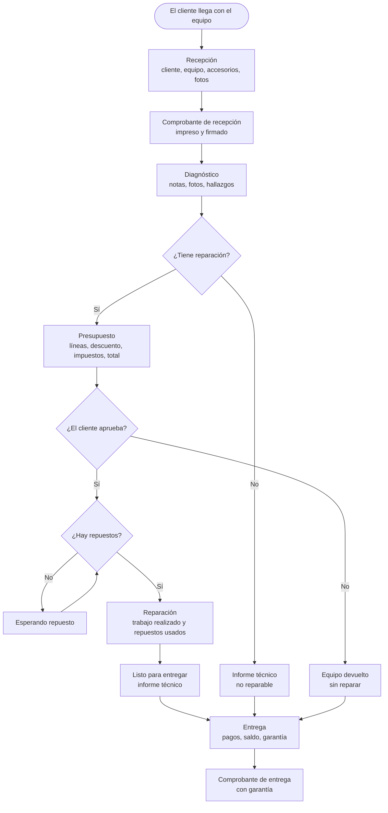
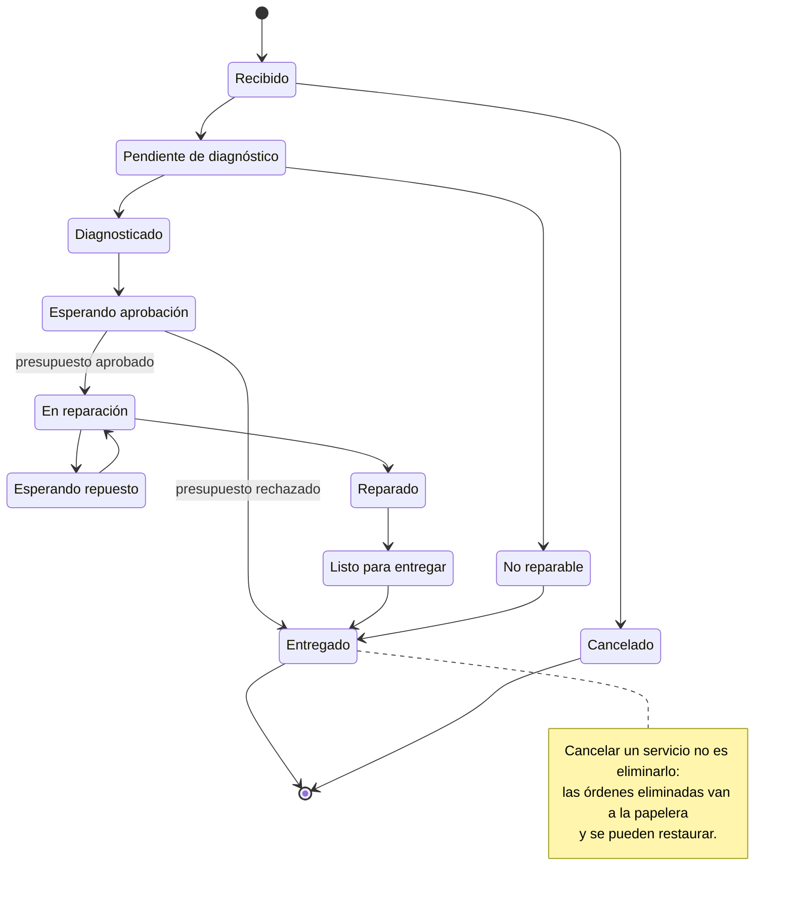
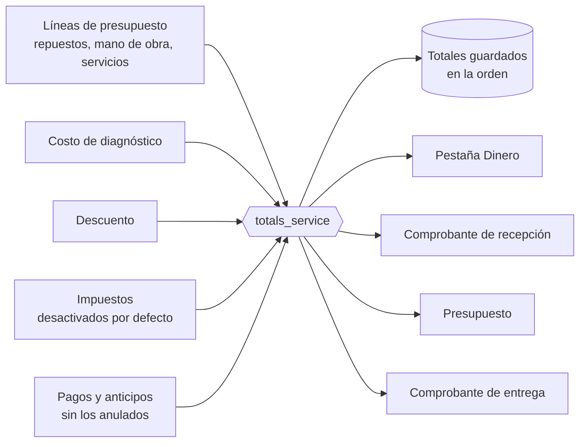
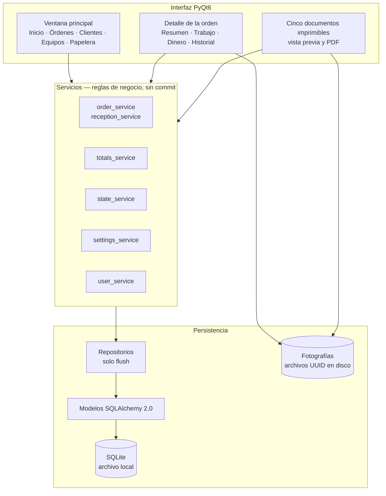
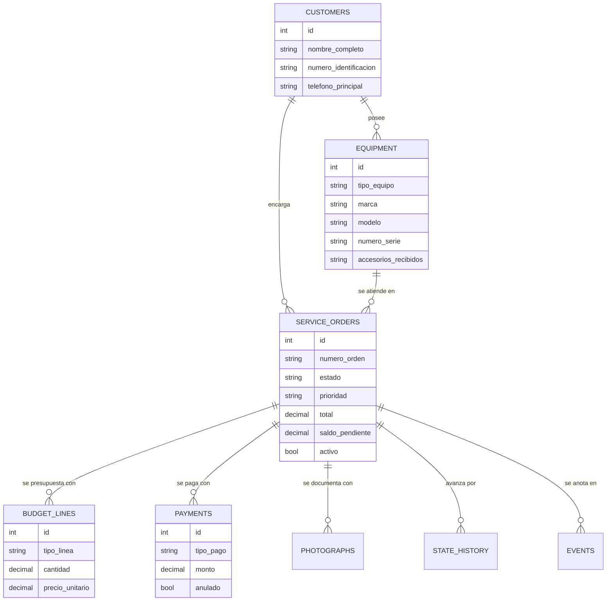
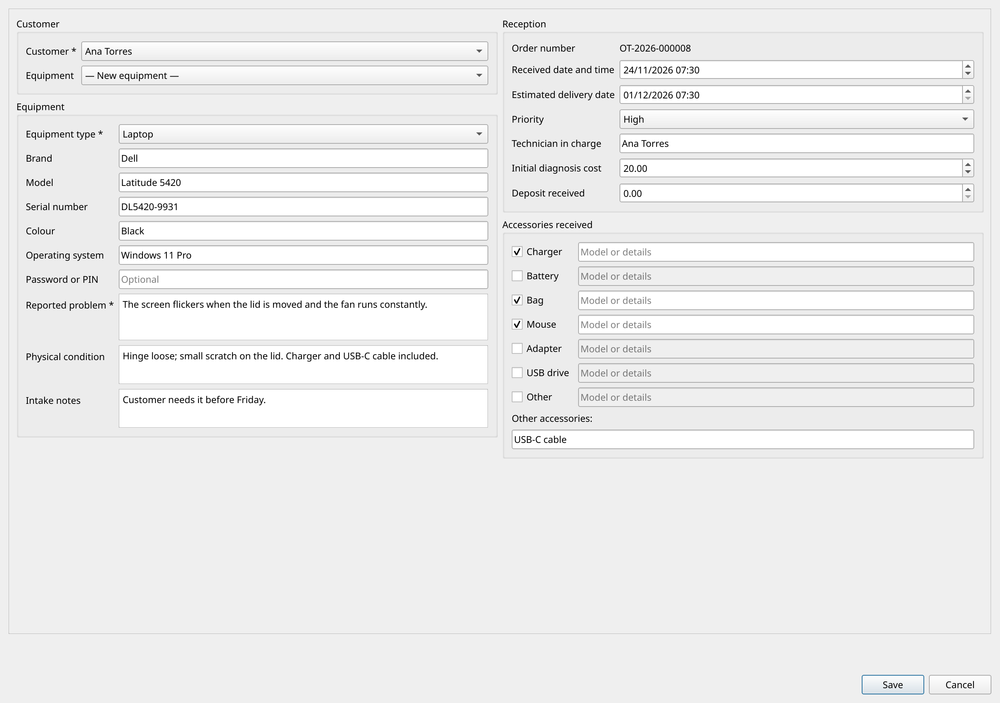
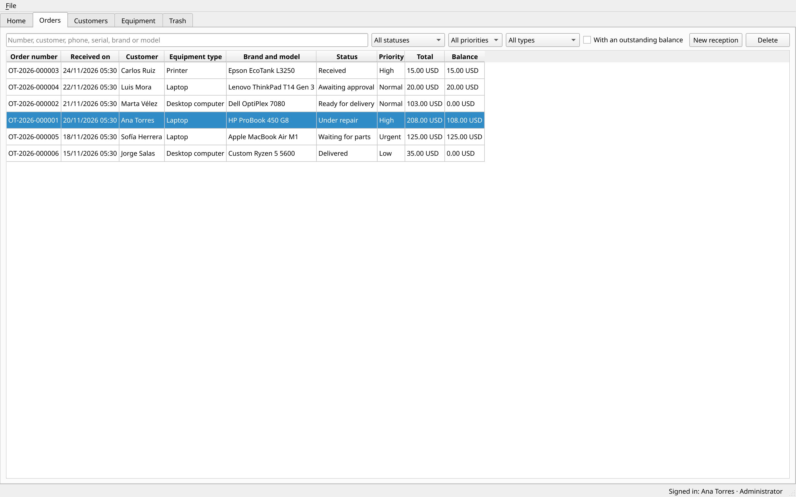
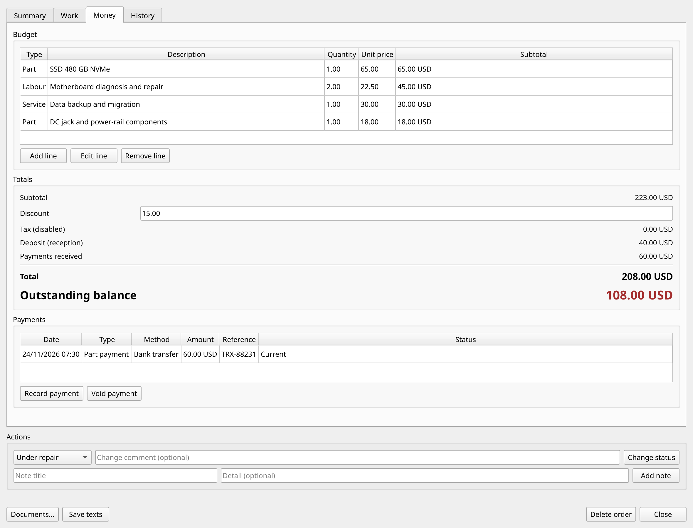
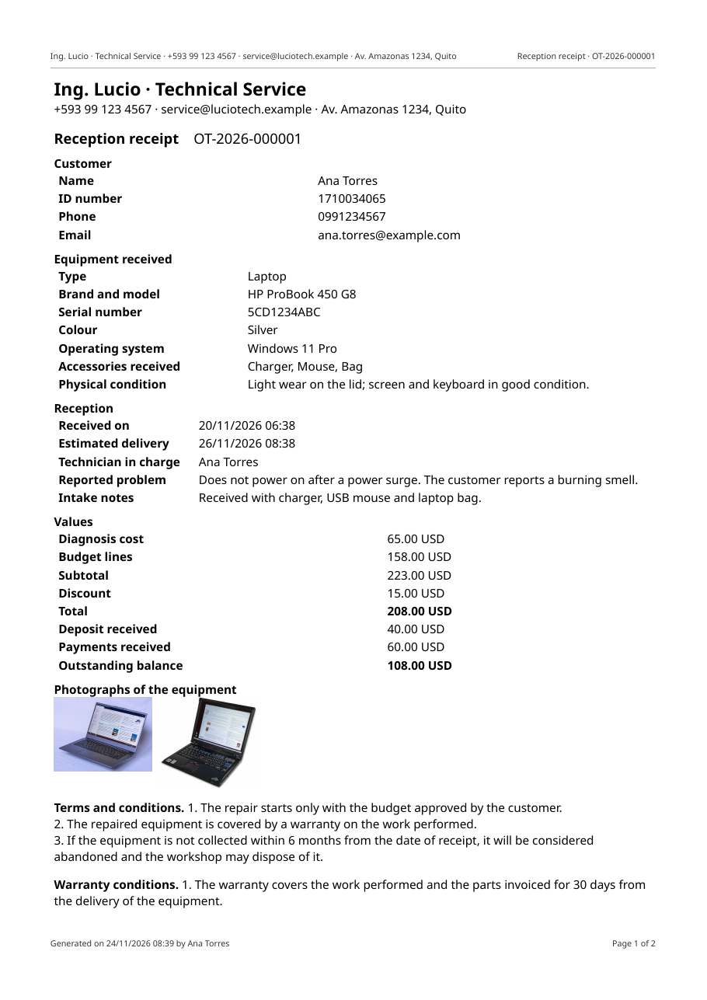

# LucioTech Service Manager

<p align="center">
  <strong>Gestión de escritorio sin conexión para un taller de reparaciones</strong><br/>
  Recepción → diagnóstico → presupuesto → reparación → entrega, con la documentación lista para imprimir.
</p>

<p align="center">
  <a href="LICENSE"></a>
  
  
  
  
  
  
  
  
</p>

**Español** · [🇬🇧 Read in English](README.md)

Aplicación de escritorio escrita en Python 3 y PyQt6 para registrar la recepción, el diagnóstico, la reparación y la entrega de equipos electrónicos en el servicio técnico del **Ing. Lucio**. Funciona completamente sin conexión: la base de datos, las fotografías y los documentos impresos nunca salen del ordenador.

Este README está escrito para dos lectores a la vez. Si reparas equipos, empieza por [Por qué un técnico lo usaría](#por-qué-un-técnico-lo-usaría) y [Cómo funciona](#cómo-funciona); si eres desarrollador, las secciones [Estructura del proyecto](#estructura-del-proyecto) y [Pruebas](#pruebas) te pondrán en marcha.

> **Estado:** las fases 1 (núcleo ejecutable), 2 (diagnóstico, textos predefinidos y fotografías) y 3 (presupuestos, pagos, PDF e impresión) están cerradas. La fase 3 entregó las líneas de presupuesto y la pestaña **Dinero**, la papelera con restauración, los cinco documentos de §13.1 (comprobante de recepción, presupuesto, informe técnico, comprobante de entrega e historial completo) con numeración de páginas, encabezado y pie, papel A4/Carta, márgenes configurables y exportación a PDF con un nombre descriptivo, el detalle de la orden en cuatro pestañas, las cuentas de usuario con acceso por contraseña y la pantalla de **Configuración** para los datos del taller, los impuestos, los términos y condiciones y la garantía. La fase 4 (reportes, respaldos, temas y empaquetado) es la siguiente y aún no ha comenzado; la interfaz multilingüe de §21 ya está disponible. Consulta [`ROADMAP.md`](ROADMAP.md) para el detalle.

## Por qué un técnico lo usaría

- **Una orden por equipo, desde el mostrador hasta la entrega.** La orden guarda el cliente, el equipo, el problema reportado, el diagnóstico, las fotografías, el presupuesto, cada pago y todo el historial en un solo lugar. Nada vive al mismo tiempo en un cuaderno, una hoja de cálculo y una carpeta.
- **La documentación forma parte del flujo, no es un trabajo aparte.** Los cinco documentos del taller —comprobante de recepción, presupuesto, informe técnico, comprobante de entrega e historial completo— se generan con los datos que ya escribiste, con el encabezado del taller, la numeración de páginas y los términos legales que configuraste.
- **El dinero tiene una sola fórmula.** Las líneas de presupuesto, el costo de diagnóstico, el descuento, los impuestos, los anticipos, los pagos y el saldo se calculan en un único lugar, así que la pantalla, el comprobante, el presupuesto y el comprobante de entrega nunca se contradicen.
- **Funciona sin internet y sin cuentas en la nube.** Un archivo SQLite guarda todo; el programa no envía nada a ningún servidor. Eso importa en un taller con conexión inestable y para los datos del cliente, que deben quedarse en el banco de trabajo.
- **Cada técnico firma su propio trabajo.** Cuentas con roles, el nombre de la sesión en la barra de estado y ese mismo nombre impreso en el historial y en el pie de cada documento.
- **Nada se tira.** Eliminar una orden es lógico: pasa a la papelera y se puede restaurar. Los pagos se anulan, no se borran, y cada cambio de estado queda registrado.

## Cómo funciona

Los diagramas siguientes son el camino más corto para entender el programa. Todos se renderizan de forma nativa en GitHub.

### Un día en el taller

Lo que hace el técnico y qué documento sale de cada paso.



### La vida de una orden

Los estados por los que pasa la orden. Coinciden con el selector de estado y con el botón **Siguiente paso** de la ventana de la orden; hoy se puede pasar de cualquier estado a cualquier otro, porque las reglas de transición siguen pendientes.



### Una sola fuente de verdad para el dinero

Cada importe de la pantalla y del papel sale de la misma fórmula de totales (§5.3). Por eso un pago anulado en la pestaña **Dinero** también desaparece del comprobante de entrega.



### Dentro de la aplicación

La interfaz nunca escribe SQL: llama a los servicios, los servicios usan los repositorios, los repositorios usan SQLAlchemy y SQLAlchemy habla con el archivo SQLite local.



### El modelo de datos

Las tablas que importan en un día normal. `state_history` y `events` son la pista de auditoría de la orden; `usuarios` no se enlaza con clave foránea porque el historial guarda el nombre de quien firmó cada cambio.



## Capturas

Todas salen de los datos de demostración que crea `tools/capture-screenshots.py`; ninguno pertenece a un taller real.

| Recepción | Órdenes |
| --- | --- |
|  |  |
| Cliente, equipo, accesorios y anticipo en una sola pasada. | Búsqueda, filtros y el saldo de cada orden. |

| Dinero | Comprobante de recepción |
| --- | --- |
|  |  |
| Líneas de presupuesto, pagos y saldo, con la misma fórmula que el papel. | Lo que firma el cliente, con los términos y la garantía. |

## Contenido

- [Por qué un técnico lo usaría](#por-qué-un-técnico-lo-usaría)
- [Cómo funciona](#cómo-funciona)
- [Capturas](#capturas)
- [Requisitos](#requisitos)
- [Instalación en Linux](#instalación-en-linux)
- [Instalación en Windows](#instalación-en-windows)
- [Ejecutar la aplicación](#ejecutar-la-aplicación)
- [Idiomas](#idiomas)
- [Probar la interfaz](#probar-la-interfaz)
- [Comprobante de recepción y términos y condiciones](#comprobante-de-recepción-y-términos-y-condiciones)
- [Configuración y textos legales editables](#configuración-y-textos-legales-editables)
- [Pruebas](#pruebas)
- [Estructura del proyecto](#estructura-del-proyecto)
- [Ubicación de los datos](#ubicación-de-los-datos)
- [Política de almacenamiento de contraseñas](#política-de-almacenamiento-de-contraseñas)
- [Usuarios y acceso](#usuarios-y-acceso)
- [Solución de problemas](#solución-de-problemas)
- [Licencia](#licencia)

## Requisitos

- Windows 10 u 11 (64 bits) es compatible. El código distingue la plataforma y guarda sus datos bajo `%APPDATA%` / `%LOCALAPPDATA%` en Windows.
- Linux (Debian, Ubuntu, MX Linux o un derivado) es la plataforma principal.
- Python 3.11 o superior (64 bits). En Windows se recomienda Python 3.12 o 3.13.
- En Windows no hacen falta paquetes de sistema adicionales: PyQt6 incluye su propio entorno de Qt en el wheel `PyQt6-Qt6`.

### Instalar Python en Windows

1. Descarga el instalador desde <https://www.python.org/downloads/windows/>.
2. Durante la instalación, marca **Add python.exe to PATH** e **Install the py launcher**.
3. Compruébalo en una terminal:

   ```bat
   py -3.13 --version
   ```

   Deberías ver algo como `Python 3.13.x`. Si `py` no aparece, reinstala Python con la opción del lanzador activada.

## Instalación en Linux

Linux (Debian, Ubuntu, MX Linux o un derivado) es la plataforma principal. Ejecuta estos comandos en una terminal desde la carpeta del proyecto. Hay dos formas de instalarlo: los paquetes de la distribución (opción A, sin entorno virtual) o un entorno virtual con `pip` (opción B).

### 1. Bibliotecas del sistema para Qt 6

PyQt6 trae su propio entorno de Qt dentro del wheel, pero el plugin de plataforma `xcb` todavía necesita algunas bibliotecas del sistema. En Debian, Ubuntu o MX Linux:

```bash
sudo apt install libxcb-cursor0 libxkbcommon-x11-0 libegl1 libgl1
```

`libxcb-cursor0` es la que falta con más frecuencia: sin ella la aplicación se detiene con `Could not load the Qt platform plugin "xcb"` aunque PyQt6 se haya importado bien.

### 2. Opción A — paquetes de la distribución (sin entorno virtual)

Debian 13 (trixie), Ubuntu 25.04 y posteriores incluyen las cuatro dependencias como paquetes de la distribución. Instálalos con `apt`:

```bash
sudo apt install python3-pyqt6 python3-sqlalchemy python3-alembic python3-reportlab qt6-translations-l10n
```

`qt6-translations-l10n` es opcional: aporta los textos en español de los diálogos propios de Qt (vista previa de impresión, diálogos de archivos y advertencias). Después arranca el programa desde la carpeta del proyecto:

```bash
PYTHONPATH=src python3 -m luciotech.main
```

Sin entorno virtual, sin activación y sin nada instalado con `pip`: `PYTHONPATH` apunta ese único comando a `src/`, y los módulos vienen de los paquetes en `/usr/lib/python3/dist-packages`, así que `sudo apt upgrade` mantiene la aplicación al día junto con el resto del sistema.

La aplicación necesita **SQLAlchemy 2.0 o superior**. Debian 13 y Ubuntu 25.04 o posteriores traen 2.0.x, pero Debian 12 (bookworm) y Ubuntu 24.04 LTS todavía traen 1.4.50, con la que la aplicación no arranca. Compruébalo con:

```bash
python3 -c "import sqlalchemy; print(sqlalchemy.__version__)"
```

Si la respuesta empieza por `1.4`, usa la opción B.

### 3. Opción B — entorno virtual

Solo tienes que hacerlo la primera vez:

```bash
python3 -m venv .venv
.venv/bin/python -m pip install --upgrade pip
.venv/bin/python -m pip install -r requirements.txt
```

Llamar a `.venv/bin/python` directamente sustituye a la activación del entorno, así que no hay ningún `source` que equivocar. `PyQt6` ocupa unos 75 MB, por lo que este paso puede tardar unos minutos.

### 4. Ejecutarlo con el entorno virtual

```bash
./run.sh
```

`run.sh` usa el intérprete del `.venv`, apunta `PYTHONPATH` a `src/` solo para ese comando y arranca la aplicación, así que no hay que instalar nada más en el entorno aparte de los requisitos. La línea equivalente es:

```bash
PYTHONPATH=src .venv/bin/python -m luciotech.main
```

Si git no conservó el bit de ejecución, ejecuta `chmod +x run.sh` una vez. Para tener el comando `luciotech-service-manager`, instala el paquete en modo editable una vez: `.venv/bin/python -m pip install -e .`.

## Instalación en Windows

Los comandos siguientes funcionan en **PowerShell**, **cmd.exe** y **Git Bash**. Ejecútalos desde la carpeta del proyecto.

### 1. Crear el entorno virtual (la carpeta `.venv` se crea dentro del proyecto):

   ```bat
   py -3.13 -m venv .venv
   ```

### 2. Activarlo. Elige el comando de tu shell:

Tendrás que repetir este paso la próxima vez que quieras ejecutar el programa desde su código fuente:

Elige uno:

**:: PowerShell**

```bat
.\.venv\Scripts\Activate.ps1
```

**:: cmd**

```bat
.venv\Scripts\activate.bat
```

**:: Git Bash**

```bat
source .venv/Scripts/activate
```

#### 2.2 Tras la activación, el indicador muestra `(.venv)`.

   > **Nota para PowerShell:** si la activación falla con "running scripts is disabled on this system", permite scripts para el usuario actual una vez:
   >
   > ```powershell
   > Set-ExecutionPolicy -Scope CurrentUser -ExecutionPolicy RemoteSigned
   > ```
   >
   > Como alternativa, omite la activación y llama al intérprete por su ruta: `.venv\Scripts\python.exe -m pip ...`.

### 3. Instalar las dependencias:

Solo tienes que hacerlo la primera vez:

```bat
python -m pip install --upgrade pip
python -m pip install -r requirements.txt
```

`PyQt6` ocupa unos 75 MB, por lo que este paso puede tardar unos minutos.

### 4. Instalar el paquete en sí (crea el comando `luciotech-service-manager`):

Solo tienes que hacerlo la primera vez:

```bat
python -m pip install -e .
```

## Ejecutar la aplicación

Tendrás que repetir este paso la próxima vez que quieras ejecutar el programa desde su código fuente:

Con el entorno virtual activado, desde la carpeta del proyecto:

```bat
python -m luciotech.main
```

En Linux, `./run.sh` desde la carpeta del proyecto hace lo mismo sin activar nada. Con los paquetes de la distribución de la opción A no hay `.venv` que usar: `PYTHONPATH=src python3 -m luciotech.main`, como se muestra en [Instalación en Linux](#instalación-en-linux).

> **¿Instalado o ejecutado sin instalar? ¿Veré mis cambios?**
> Ambos caminos arrancan el programa directamente desde la carpeta `src/` del disco, así que cualquier cambio que guardes en el código se recoge la próxima vez que lo inicies. No se copia ni se congela nada.
> - **Activado + `pip install -e .`** (los pasos anteriores): la instalación editable registra un enlace vivo entre el paquete `luciotech` y `src/`, y pone el intérprete del `.venv` (con todas las dependencias) primero en tu `PATH`. Después puedes ejecutar `python -m luciotech.main` desde cualquier terminal, sin `PYTHONPATH`.
> - **`PYTHONPATH=src`** (más abajo): apunta el `python` actual a `src/` solo para ese comando. No registra ningún enlace ni escribe nada, así que debes repetir `PYTHONPATH=src` cada vez que lo inicies. Va bien para una ejecución rápida, pero el Python que uses tiene que tener las dependencias, normalmente el del `.venv`.

## Idiomas

El programa está escrito en inglés e incluye una traducción al español; el idioma se cambia en **Archivo ▸ Configuración ▸ Idioma**. El cambio se guarda en la base de datos y surte efecto la próxima vez que se inicie la aplicación. Si no existe un catálogo para el idioma elegido, el programa muestra sus textos fuente en inglés.

Los textos por defecto que trae el programa también siguen el idioma elegido: los tipos de equipo, las frases predefinidas y las condiciones de servicio y garantía. Los tipos de equipo, los accesorios y las notas generadas del historial se guardan con su valor original y se traducen solo al mostrarlos, así que las órdenes existentes, los tipos personalizados y la sugerencia de accesorios siguen funcionando al cambiar de idioma.

Las traducciones usan el flujo estándar de Qt:

| Archivo | Para qué sirve |
| ------- | -------------- |
| `translations/luciotech_es.ts` | Catálogo editable, que se abre y revisa en **Qt Linguist** |
| `src/luciotech/ui/translations/luciotech_es.qm` | Catálogo compilado que la aplicación carga al arrancar |
| `tools/update-translations.sh` | Ejecuta `pylupdate6` y `lrelease` para cada `.ts` |

Para añadir un idioma:

1. Crea el catálogo con `pylupdate6` (o copia un `.ts` existente y tradúcelo en Qt Linguist):

   ```bash
   .venv/bin/pylupdate6 $(find src/luciotech -name '*.py') -ts translations/luciotech_fr.ts
   ```

2. Traduce los mensajes en **Qt Linguist** (`linguist translations/luciotech_fr.ts`) y guarda.
3. Compílalo en la carpeta del paquete:

   ```bash
   lrelease translations/luciotech_fr.ts -qm src/luciotech/ui/translations/luciotech_fr.qm
   ```

4. Vuelve a abrir el programa: el nuevo idioma aparece en la lista de Configuración. El archivo `.qm` tiene que viajar con la aplicación.

Cualquier idioma añadido de esta forma se lista automáticamente; `ui/translations.py` solo contiene los nombres nativos de los más comunes. `lrelease` viene de las herramientas de Qt (`qt6-linguist-tools` en Debian/Ubuntu), y `pylupdate6` está incluido con PyQt6.

## Ejecutar sin instalar el paquete

Para ejecutar sin instalar el paquete, define la ruta del código para el comando actual, elige uno:

**:: PowerShell**

```bat
$env:PYTHONPATH = "src"; python -m luciotech.main
```

**:: cmd.exe**

```bash
set PYTHONPATH=src && python -m luciotech.main
```

**:: Git Bash**

```bat
PYTHONPATH=src python -m luciotech.main
```

O usa directamente el comando instalado (sin activación):

```bat
.venv\Scripts\luciotech-service-manager.exe
```

Al arrancar, la aplicación crea la base de datos si no existe y aplica las migraciones.

La migración 0005 crea la tabla `usuarios`, así que la aplicación puede abrirse con una cuenta por técnico; una base que no tenía cuentas pide la primera al abrirse.

La migración 0004 elimina `costo_repuestos` y `costo_mano_obra`, dos columnas del esquema de la fase 1 que no tenían campo en la interfaz y siempre valían cero. El presupuesto detallado vive en las líneas de la pestaña **Dinero** desde la migración 0002, así que el subtotal ahora es `costo_diagnostico + suma(líneas)` y no puede contar dos veces el mismo importe. Las órdenes existentes se migran en el sitio: las columnas se eliminan con `ALTER TABLE ... DROP COLUMN`, sin reconstruir la tabla ni tocar los pagos, líneas, fotografías e historial que apuntan a la orden. Volver a 0003 devuelve las columnas a cero.

La ventana principal se abre maximizada y se adapta al tamaño de la pantalla. Si la haces más pequeña, el tamaño mínimo es 800×560 píxeles; los formularios tienen barras de desplazamiento para que todos los campos sigan accesibles.

## Probar la interfaz

### Usar una base de datos temporal

Para mantener los datos de prueba aparte de los reales, inicia la aplicación con una base de datos temporal.

En Linux:

```bash
LUCIOTECH_DATABASE_URL=sqlite:////tmp/luciotech-prueba.sqlite3 ./run.sh
```

Borra `/tmp/luciotech-prueba.sqlite3` para empezar de cero. Con el entorno virtual, el mismo comando es:

```bash
LUCIOTECH_DATABASE_URL=sqlite:////tmp/luciotech-prueba.sqlite3 PYTHONPATH=src .venv/bin/python -m luciotech.main
```

Con los paquetes de la distribución (opción A), es:

```bash
LUCIOTECH_DATABASE_URL=sqlite:////tmp/luciotech-prueba.sqlite3 PYTHONPATH=src python3 -m luciotech.main
```

En Windows, usa una ruta dentro del proyecto o una carpeta temporal:

```bat
:: cmd.exe
set LUCIOTECH_DATABASE_URL=sqlite:///%TEMP%\luciotech-prueba.sqlite3
set PYTHONPATH=src
python -m luciotech.main

:: PowerShell
$env:LUCIOTECH_DATABASE_URL = "sqlite:///$env:TEMP/luciotech-prueba.sqlite3"
$env:PYTHONPATH = "src"
python -m luciotech.main

:: Git Bash
LUCIOTECH_DATABASE_URL=sqlite:///$TEMP/luciotech-prueba.sqlite3 PYTHONPATH=src python -m luciotech.main
```

> **Formato de las rutas en Windows:** usa barras inclinadas en la URL y cuatro barras antes de una ruta absoluta (`sqlite:///C:/ruta/base.sqlite3`). Las barras invertidas no funcionan en las URL de SQLAlchemy.

Para empezar de cero, borra ese archivo antes de arrancar:

```bat
:: cmd.exe
del "%TEMP%\luciotech-prueba.sqlite3"

:: PowerShell
Remove-Item "$env:TEMP/luciotech-prueba.sqlite3" -ErrorAction SilentlyContinue
```

### Qué puedes probar

1. **Primer arranque:** la primera vez que la aplicación abre una base de datos muestra **Bienvenido a LucioTech Service Manager** y pide la cuenta de administrador: nombre completo, nombre de usuario y contraseña (al menos 4 caracteres, escrita dos veces). Ese nombre es el que aparecerá en los documentos que imprimas. Después, cada arranque empieza con la ventana de acceso, que lista las cuentas del taller en un desplegable: elige tu nombre y escribe solo tu contraseña.
2. **Inicio:** las tarjetas muestran conteos en vivo. Con una base vacía muestran 0 o `0.00 USD`.
3. **Clientes:** pulsa **Nuevo cliente** y prueba:
   - dejar el nombre vacío (debe mostrar «Campo obligatorio»);
   - una cédula de 10 dígitos con el dígito verificador incorrecto, como `1710034066` (debe rechazarse);
   - la cédula válida `1710034065`;
   - un teléfono con letras, como `099ABC4567` (debe rechazarse);
   - guardar un segundo cliente con el mismo teléfono en otro formato (`099 123-4567`): la aplicación debe pedir confirmación antes de guardar.
4. **Equipos:** pulsa **Nuevo equipo**. Si no hay clientes, se te pide registrar uno primero. La contraseña está oculta; el botón **Mostrar** la revela.
5. **Órdenes:** pulsa **Nueva recepción**:
   - elige un cliente existente o **Cliente nuevo** (los campos aparecen en el mismo formulario);
   - marca accesorios, describe el problema reportado y, si quieres, introduce un anticipo;
   - comprueba que el número de orden previsto es `OT-AAAA-000001` antes de guardar;
   - tras guardar, un pequeño diálogo ofrece **Imprimir comprobante** (abre la vista previa del comprobante de recepción), **Abrir orden** y **Cerrar**;
   - registra dos equipos con el mismo número de serie: la aplicación debe advertir y pedir confirmación;
   - en la lista, prueba el buscador y los filtros por estado, prioridad, tipo de equipo y saldo pendiente;
   - si el cliente ya tiene un equipo registrado, el campo **Equipo** lo lista. Selecciónalo y sus datos quedan bloqueados: la orden usa ese mismo equipo y no se crea uno nuevo.
   - selecciona una fila y pulsa **Eliminar** para enviar la orden a la papelera. La aplicación pide confirmación primero y la orden se puede restaurar después.
6. **Detalle de la orden:** haz doble clic en una orden de la lista. La ventana se abre al mayor tamaño que cabe cómodamente en la pantalla (hasta el 92 % de ella, nunca más de 1180 px) y no puede reducirse por debajo de su propio contenido, así que los totales de la pestaña **Dinero** nunca se cortan. Tiene **cuatro pestañas**, no las nueve del borrador original: **Resumen**, **Trabajo**, **Dinero** e **Historial**. Nueve pestañas del mismo peso obligaban a buscar cada campo en una fila de botones; con cuatro áreas la pregunta «¿dónde está esto?» se responde sola. Dentro de **Trabajo** las cuatro superficies de escritura se turnan en una segunda fila, así que ninguna queda con un par de líneas visibles.
   - **Resumen (Summary):** se abre con el recuadro **Siguiente paso**: un único botón que hace lo que pide el estado actual (empezar el diagnóstico, entregar el presupuesto, marcar la reparación como terminada, entregar el equipo…) y, cuando el paso entrega un documento al cliente, abre su vista previa. El selector de estado queda intacto, así que cualquier salto sigue siendo posible. Debajo, la orden se lee por secciones: **Orden** (número, estado, prioridad, cliente, equipo, número de serie, ingreso, fechas estimada y de entrega, técnico responsable, problema reportado, total, anticipo y saldo), **Cliente** (datos de contacto, otras órdenes del cliente y saldo total pendiente; las órdenes canceladas quedan excluidas) y **Equipo** (datos técnicos, con la contraseña oculta hasta **Mostrar contraseña**).
   - **Trabajo (Work):** lo que escribe el técnico, más las fotografías. **Diagnóstico**, **Reparación** y **Recomendaciones** (fase 2): editores de texto enriquecido para el diagnóstico técnico, el trabajo realizado y las recomendaciones al cliente. Los textos se guardan solos poco después de dejar de escribir y también al cerrar el diálogo, así que nada se pierde si olvidas pulsar **Guardar textos**. Escribe algo con negrita o listas, cierra la ventana, ábrela de nuevo y comprueba que el texto y el formato siguen ahí. La barra de herramientas cubre el conjunto completo de §8: negrita, cursiva, subrayado, tachado, listas, sangría, alineación (incluida justificar), familia y tamaño de fuente, color de texto y de fondo, limpiar formato, zoom, cortar, copiar, pegar, pegar como texto sin formato, tabla, imagen, línea horizontal, buscar y reemplazar, vista previa de impresión, textos predefinidos, deshacer y rehacer.
   - **Fotografías** (fase 2): fotografías del equipo. Usa **Importar…**, **Pegar** (botón o `Ctrl+V` con esta pestaña enfocada) o arrastra imágenes desde el gestor de archivos; se aceptan JPEG, PNG, WEBP y BMP de hasta 20 MB (puedes probar con las muestras de `Ordenadores-de-ejemplo/`). Cada foto se copia en la carpeta de datos de la aplicación con un nombre UUID nuevo, así que el archivo original se puede mover o borrar. El doble clic o **Ver** abre el visor; **Rotar izquierda/derecha** gira la imagen guardada; **Editar…** cambia la descripción y el tipo; **Quitar** borra el registro y su archivo; **Subir/Bajar** reordenan la galería.
   - **Dinero (Money)** (fase 3): el dinero de la orden, y el único lugar donde se registra dinero. La tabla **Presupuesto** lista las líneas (tipo, descripción, cantidad, precio unitario y subtotal); **Añadir línea**, **Editar línea** (o doble clic) y **Quitar línea** trabajan sobre la fila seleccionada. El panel **Totales** recalcula en cuanto cambia algo: subtotal, descuento, impuestos, anticipo y pagos encima de la línea, y debajo **Total** y **Saldo pendiente** en un tipo mayor. El saldo es el número más grande de la pantalla y se vuelve rojo mientras se debe dinero y verde cuando llega a cero. Escribe un **Descuento** y pulsa Enter o sal del campo para aplicarlo. La tabla **Pagos** lista cada pago y reembolso con su estado; **Registrar pago** abre un diálogo (tipo, método, monto, referencia, notas) y **Anular pago** anula el seleccionado pidiendo un motivo. La anulación es lógica: el pago sigue en la lista y en el historial marcado como *Anulado*, pero deja de contar para el saldo. Si registras un pago de tipo *Anticipo* en una orden que ya trae un anticipo de la recepción, la aplicación lo registra y avisa de que el anticipo se restará dos veces. La pestaña nunca escribe SQL ni hace su propia aritmética: pasa por `budget_service`, `order_detail_service` y la única fórmula de totales de `totals_service` (§5.3).
   - **Historial (History)** (fase 3): cada cambio de estado, nota y pago de la orden en orden cronológico, con fecha, tipo, detalle y usuario. Está junto a **Dinero** porque es lo que se mira cuando un cobro está en duda, y usa toda la altura de la ventana: **Detalle** ocupa el ancho libre y las otras tres columnas se ajustan a su contenido, así que nada se corta. La tabla es de solo lectura; la nota que escribe en ella vive en el grupo **Acciones** de abajo.
   - Desde la parte inferior del diálogo puedes guardar los textos a demanda, abrir **Documentos…** (elegir qué documento previsualizar, imprimir o guardar como PDF) y **enviar la orden a la papelera**; cambiar el estado y añadir una nota viven en el grupo **Acciones** de arriba, y elegir **Entregado** allí registra la fecha de entrega y el evento, igual que el botón **Siguiente paso**. Los pagos **no** se registran desde aquí: hay un único botón **Registrar pago**, en la pestaña **Dinero**, para que el dinero pase siempre por la misma puerta.
7. **Usuarios:** con una cuenta de administrador, **Archivo ▸ Usuarios…** (o `Ctrl+U`) lista las cuentas del taller. **Nuevo usuario…** crea una con su nombre completo, su nombre de usuario, su rol (Administrador o Técnico) y su contraseña. **Editar…** cambia el nombre y el rol, **Cambiar contraseña…** pone una nueva y **Desactivar** bloquea la cuenta sin borrarla, porque el historial de las órdenes conserva el nombre de quien hizo cada cambio. El nombre de usuario no se puede cambiar una vez creado, y el último administrador activo no se puede desactivar ni degradar. **Archivo ▸ Cambiar mi contraseña…** pide la contraseña actual, y **Archivo ▸ Cerrar sesión** vuelve a la ventana de acceso sin cerrar el programa. El nombre de la sesión aparece en la barra de estado y es el que se escribe en el historial y en el pie de cada documento que imprime ese usuario.
8. **Configuración:** con una cuenta de administrador, **Archivo ▸ Configuración…** abre tres pestañas. Edita el encabezado del taller y el IVA en **Taller**, el papel, los márgenes, la validez del presupuesto, el período de retención y los tipos de equipo en **Documentos**, y —lo más importante— todos los **términos y condiciones** y el **texto de la garantía** en **Términos y garantía**, junto con los días de garantía que reciben las órdenes nuevas (y a los que recurren las órdenes antiguas sin días propios). Escribe unas líneas, pulsa **Guardar** y abre **Documentos…** en cualquier orden: el texto nuevo está en el comprobante de recepción, el presupuesto, el informe técnico y el comprobante de entrega. Consulta [Configuración y textos legales editables](#configuración-y-textos-legales-editables).
9. **Papelera (Trash):** la quinta pestaña lista las órdenes eliminadas. Eliminar es *lógico*: la fila sigue en la base de datos con `activo = False` y una fecha de eliminación, así que nada se pierde. Selecciona una fila y pulsa **Restaurar** para devolver la orden a la lista activa; **Abrir** (o un doble clic) muestra sus detalles en modo de solo lectura, con el botón de eliminar desactivado. La lista **Órdenes** nunca muestra órdenes eliminadas, y la papelera nunca muestra activas.
10. **Atajos:** `F5` actualiza todas las pantallas, `Ctrl+U` abre la lista de usuarios (solo administradores) y `Ctrl+Q` cierra el programa.
11. **Reinicio:** cierra la aplicación, vuelve a abrirla con la misma base de datos y comprueba que los datos siguen ahí.

### Todavía no implementado

- La captura desde cámara web aún no está implementada (función opcional).
- Editar la lista de textos predefinidos desde una ventana de Configuración está pendiente (fase 4); hoy la lista solo se puede cambiar por código o directamente en la base de datos. Los términos, la garantía, los meses de retención y los datos del taller **sí** se pueden editar desde **Archivo ▸ Configuración…**; consulta [Configuración y textos legales editables](#configuración-y-textos-legales-editables).
- Las imágenes insertadas en el editor de texto enriquecido apuntan al archivo original en disco. Las fotografías de la pestaña Fotografías se copian a la carpeta de datos de la aplicación, pero las imágenes del editor no.
- Copias de seguridad desde la interfaz (fase 4).
- Reglas de transición entre estados de la orden: hoy se puede poner cualquier estado desde cualquier otro.
- La papelera solo restaura; nunca se vacía sola. Borrar permanentemente una fila de la base de datos no se ofrece a propósito (§18).

### Si algo falla

Todavía no hay archivo de registro (ROADMAP §20). Si algo falla, ejecuta el programa desde una terminal y copia el mensaje de error completo que aparezca allí.

## Comprobante de recepción y términos y condiciones

El comprobante de recepción (§13.1.1) es el documento que se entrega al cliente cuando deja el equipo. Se construye como HTML en `src/luciotech/ui/documents.py` y se imprime a través del diálogo de vista previa de Qt, así que funciona sin conexión y con cualquier impresora que conozca el sistema. Contiene:

- el encabezado del taller (nombre, teléfono, correo y dirección, tomados de la configuración);
- el número de orden y la fecha y hora de ingreso;
- el cliente, el equipo (tipo, marca y modelo, número de serie, color, sistema operativo), los accesorios recibidos, el estado físico y el problema reportado;
- la fecha estimada de entrega y el técnico responsable;
- el desglose completo del dinero: costo de diagnóstico, líneas de presupuesto (repuestos y mano de obra incluidos), subtotal, descuento, impuestos, total, anticipo recibido, pagos recibidos y saldo pendiente. Las cifras salen de la misma fórmula que la pestaña **Dinero** (§5.3), así que el papel y la pantalla nunca se contradicen; las filas que valen cero se omiten, pero el total y el saldo siempre se imprimen. Los impuestos solo se imprimen cuando están activados: por defecto están desactivados, porque los precios del taller ya los incluyen;
- hasta cuatro fotografías del equipo, tomadas de la pestaña **Fotografías**;
- los términos y condiciones y las condiciones de la garantía (ambos editables en **Configuración**);
- líneas de firma para el cliente y para el taller.

La contraseña del equipo **nunca** se imprime: el documento se entrega al cliente.

**Documentos…** en la ventana de la orden abre un selector con los cinco documentos de §13.1. Todos se abren en la vista previa de impresión de Qt, que empieza **maximizada** y con la página al **100 %**, el tamaño real del papel. El valor por defecto de Qt es ajustar la hoja a la ventana, lo que en un A4 deja el texto pequeño; los controles de zoom siguen en la barra de herramientas para cuando quieras ver la página entera de un vistazo. La vista previa también lleva los botones de minimizar y maximizar —un `QDialog` normal solo recibe el de cerrar— y, si se restaura la ventana, vuelve al 90 % de la pantalla disponible (con un máximo de 1500 × 1100 px y nunca por debajo de 760 × 620), así que nunca queda en un tamaño incómodo. Desde ese mismo diálogo puedes enviar el documento a una impresora o guardarlo como PDF.

Cada página lleva un encabezado con el taller y su contacto a la izquierda y el documento con el número de orden a la derecha, una línea debajo, y un pie con la fecha de generación y **Página X de Y**. El espaciado de las plantillas se convierte de puntos a píxeles antes de imprimir (`scale_lengths`): Qt escala las fuentes escritas en puntos pero descarta en silencio las unidades físicas en `margin` y `padding`, así que cada sección se imprimía pegada a la anterior. El mobiliario de página se dibuja en `ui/print_support.py`: Qt pagina el `QTextDocument` pero no numera las páginas, así que el área imprimible se divide en una banda de encabezado, el cuerpo y una banda de pie, y el contenido se desplaza página a página para que nunca invada el pie.

El papel y los márgenes vienen de la tabla `configuracion` (`tamano_papel` = `A4` o `Carta`, `margen_pagina_mm` = 15 por defecto) y se pueden cambiar para una impresión concreta en **Configuración de página**, dentro de la vista previa. **Guardar como PDF** pregunta dónde guardar y propone un nombre descriptivo, por ejemplo `OT-2026-000001_Juan-Perez_Informe-Tecnico.pdf`; los acentos se eliminan y el nombre del cliente se une con guiones para que el archivo sea seguro en cualquier sistema.

Los diálogos propios de Qt (barra de la vista previa, configuración de página, diálogos de archivos, los botones de las advertencias) se muestran en español: `ui/translations.py` carga los archivos `qtbase_es` y `qt_es` que vienen con PyQt6. Si faltaran, la aplicación seguiría funcionando con esos textos en inglés.

| Documento | Cuándo se entrega | Qué contiene |
|---|---|---|
| **Comprobante de recepción** | Cuando se deja el equipo | Cliente, equipo, accesorios, estado físico, fotografías, importes, términos y ambas firmas |
| **Presupuesto** | Antes de empezar el trabajo | Concepto, cantidad, precio unitario e importe por línea, subtotal, descuento, impuestos (solo si están activados) y total, validez (15 días desde la fecha de ingreso, `presupuesto_validez_dias`) y un espacio para la aprobación del cliente |
| **Informe técnico** | Cuando termina el trabajo | Diagnóstico, trabajo realizado, repuestos usados, recomendaciones, fotografías antes y después, importes y garantía |
| **Comprobante de entrega** | Cuando se devuelve el equipo | Datos de la orden, trabajo realizado, cada pago con su estado, saldo, garantía, declaración de conformidad y ambas firmas |
| **Historial completo** | A petición o para el archivo | Cada cambio de estado, nota y pago en orden cronológico |

La lista **Órdenes** conserva su propia acción **Imprimir comprobante**, que imprime directamente el comprobante de recepción.

Los términos y condiciones vienen de la clave de configuración `condiciones_servicio`. El texto por defecto establece que un equipo que no se retira dentro del período de retención se considera abandonado y puede darse de baja:

> Si el equipo no es retirado dentro de **6** meses contados desde la fecha de ingreso, se considerará abandonado y el taller podrá darlo de baja y disponer de él.

El número de meses no está fijo en el texto: el marcador `{meses}` se sustituye al imprimir por el valor de `retencion_meses`, así que cambiar el período de retención actualiza todos los documentos a la vez. Claves relacionadas:

| Clave | Valor por defecto | Significado |
|---|---|---|
| `condiciones_servicio` | `DEFAULT_SERVICE_TERMS` en `config.py` | Términos impresos en los cuatro documentos del cliente. `{meses}` se sustituye. |
| `condiciones_garantia` | `DEFAULT_WARRANTY_TERMS` en `config.py` | Texto de la garantía en esos mismos documentos. Se sustituyen `{dias}`, `{orden}` y `{meses}`; vacío significa que no hay bloque de garantía. |
| `garantia_dias` | `30` | Días de garantía para órdenes nuevas y para cualquier orden sin número propio. Ponlo en `0` para desactivar la garantía en todos los documentos. |
| `retencion_meses` | `6` | Meses antes de que un equipo no retirado pueda darse de baja. Debe ser mayor que cero; un valor inválido o vacío vuelve al valor por defecto. |
| `nombre_taller` | `Ing. Lucio` | Nombre del taller en el encabezado de los documentos. |
| `telefono_taller`, `correo_taller`, `direccion_taller` | vacío | Línea de contacto del encabezado. Las partes vacías se omiten. |

Léelas y escríbelas a través de `luciotech.services.settings_service` (`service_terms`, `service_conditions`, `warranty_terms`, `warranty_conditions`, `retention_months`, `set_service_terms`, `set_warranty_terms`, `set_retention_months`, `workshop_name`, `workshop_contact`), nunca a mano, porque esos ayudantes normalizan los valores, validan los números y sustituyen los marcadores. Estos campos se editan desde **Archivo ▸ Configuración…**; consulta la sección siguiente.

## Configuración y textos legales editables

**Archivo ▸ Configuración…** (solo administradores) abre un diálogo de tres pestañas. Todo se guarda como filas clave/valor en la tabla `configuracion` y se lee a través de `settings_service`, así que editar un texto no necesita migración ni reinicio.

| Pestaña | Qué edita |
|---|---|
| **Taller** | Nombre, teléfono, correo y dirección del taller (el encabezado de cada documento impreso), el porcentaje de IVA y si el impuesto está activo. |
| **Documentos** | Tamaño de papel, márgenes, validez del presupuesto en días, el período de retención que rellena `{meses}` y los tipos de equipo que se ofrecen en los formularios (uno por línea). |
| **Términos y garantía** | Todos los **términos y condiciones**, todo el **texto de la garantía** y los días de garantía de las órdenes nuevas (también se usan para las órdenes antiguas sin número propio). |

Los dos cuadros de texto grandes son los textos legales que se entregan al cliente. Se imprimen en el **comprobante de recepción**, el **presupuesto**, el **informe técnico** y el **comprobante de entrega** —los cuatro documentos que salen del taller—. El **Historial completo** es interno y no lleva texto legal. Cada línea que escribes se imprime en su propia línea y el texto se escapa como HTML, así que escribir `<b>` no puede romper la maqueta.

Los marcadores se sustituyen al imprimir, no se guardan en el texto:

| Marcador | Se sustituye por |
|---|---|
| `{meses}` | El período de retención de **Documentos** (`retencion_meses`, 6 por defecto). Funciona en ambos textos legales. |
| `{dias}` | Los días de garantía de esa orden concreta. |
| `{orden}` | El número de orden, p. ej. `OT-2026-000001`. |

Los dos botones **Restablecer texto por defecto** devuelven a los editores los valores de `config.py`; solo surten efecto al pulsar **Guardar**. Dejar vacío el texto de la garantía elimina el bloque **Condiciones de garantía** de todos los documentos, y poner los días de garantía en **0** apaga la garantía en todas partes. Una orden con su propio número de días lo conserva; una orden con `0` (por ejemplo, una creada antes de que existiera esta función, cuando el campo siempre valía cero) recurre al ajuste del taller, así que la documentación antigua imprime la garantía actual en vez de «Sin garantía registrada». Guardar el diálogo también recalcula los totales almacenados cuando cambia el IVA —el mismo paso que se ejecuta al arrancar— y actualiza todas las pestañas.
## Pruebas

Con el entorno virtual activado, desde la carpeta del proyecto:

```bat
python -m pytest
```

La suite usa una base de datos SQLite temporal para cada prueba y ejecuta la interfaz de Qt en modo offscreen, así que no abre ventanas. Las pruebas de interfaz usan `pytest-qt`.

### Estado de las pruebas en Windows

Verificado en Windows 11 con Python 3.13.15 y PyQt6 6.9.0: la suite completa pasa (alrededor de 1 minuto). En Linux la misma suite también pasa: **490 de 490** con `.venv/bin/python -m pytest` (Python 3.13.5, PyQt6 6.9.0, unos 50 segundos).

Antes fallaba una prueba solo en Windows: `tests/test_rich_text_editor.py::test_toolbar_rows_are_compact_and_only_grow_when_scrolling_is_needed`. La causa no era un error del producto sino una suposición dependiente de la plataforma en la prueba. La prueba redimensionaba el editor de texto enriquecido a 900 px fijos y esperaba que las dos filas de la barra cupieran sin desplazamiento horizontal. En Windows las métricas de la fuente de la barra son más anchas, así que la fila de acciones necesita **976 px** y se desplaza legítimamente a 900 px —por tanto su altura (47 px, barra más barra de desplazamiento) era correcta, y solo la fila de formato (657 px) volvía a los 33 px compactos—. En Linux la misma fila mide menos de 900 px, así que la suposición se cumplía.

Se hicieron dos cambios:

- La prueba ahora deriva los anchos de cada fila (`max(minimumWidth) + 8` para el caso ancho, la mitad de la fila más estrecha para el caso estrecho) en vez de fijar 900 px, así que ya no depende de las métricas de fuente de la plataforma.
- `_ToolbarArea` ahora recalcula su altura fija a partir de la visibilidad **real** de la barra de desplazamiento (`horizontalScrollBar().isVisible()`) tanto en `resizeEvent` como en los eventos `Show`/`Hide` de la barra. Antes la altura dependía solo de `Show`/`Hide`, así que un evento `Hide` perdido habría dejado la fila 14 px demasiado alta; con el ancho como segundo disparador, la altura siempre coincide con lo que se ve.

La altura compacta (33 px) y la expandida (47 px) no cambian; el arreglo solo elimina el riesgo de altura obsoleta y hace la prueba independiente de la plataforma.

Un detalle inofensivo mientras corre la suite: pytest imprime `Windows fatal exception: code 0x80040155` seguido de una traza que termina en `print_document` o `render_to_pdf`. Viene de construir un `QPrinter` bajo la plataforma offscreen, donde no hay un subsistema de impresión real. Es una excepción de primera oportunidad que Qt maneja internamente: las pruebas afectadas (`test_render_to_pdf_creates_a_pdf` y las pruebas de PDF de `tests/test_print_page.py`) siguen pasando y los PDF se escriben correctamente. La línea de resumen (`490 passed`) es la que cuenta.

Hay una trampa real al lado, y costó un segfault: `QPrintPreviewDialog` **no** toma posesión del `QPrinter` que recibe, guarda un puntero crudo. Pasar un temporal (`QPrintPreviewDialog(_printer(), None)`) deja la vista previa apuntando a memoria liberada y el proceso muere después, lejos de la causa. Las pruebas mantienen la impresora en una variable, y `print_document` hace lo mismo.

Si pytest se detiene con un error de permisos al eliminar una carpeta antigua bajo el directorio temporal del sistema, pasa una base nueva para que no tenga nada que limpiar:

```bat
python -m pytest --basetemp="%TEMP%\luciotech-pytest-%RANDOM%"
```

Opciones útiles mientras desarrollas:

```bat
:: detenerse en el primer fallo y mostrar la excepción
python -m pytest -x

:: ejecutar solo las pruebas de interfaz
python -m pytest tests/test_ui.py tests/test_reception_ui.py

:: una sola prueba
python -m pytest "tests/test_rich_text_editor.py::test_toolbar_has_the_essential_actions"
```

## Estructura del proyecto

```text
.
├── pyproject.toml
├── requirements.txt
├── README.md
├── README_ES.md
├── ROADMAP.md
├── AGENTS.md
├── LICENSE
├── alembic.ini
├── src/
│   └── luciotech/
│       ├── main.py               # Punto de entrada: migraciones, acceso y ventana principal
│       ├── config.py             # Nombre, app_id, organización, versión y valores por defecto
│       ├── database/
│       │   ├── connection.py     # Motor SQLite con claves foráneas activadas
│       │   ├── enums.py          # Estados, prioridades y tipos (definidos una vez)
│       │   ├── models.py         # Modelos SQLAlchemy
│       │   ├── repositories.py   # CRUD por entidad (solo flush, sin commit)
│       │   ├── migrate.py        # Aplica las migraciones de Alembic al arrancar
│       │   └── migrations/       # Revisiones de Alembic
│       ├── services/             # Reglas de negocio; reciben una sesión, nunca hacen commit
│       │   ├── user_service.py   # Cuentas, hashes PBKDF2 y roles (§19)
│       │   └── settings_service.py # Configuración clave/valor y textos legales (§5.8)
│       ├── ui/
│       │   ├── main_window.py    # Ventana principal con pestañas
│       │   ├── documents.py      # Los cinco documentos imprimibles y la vista previa (§13.1)
│       │   ├── labels.py         # Etiquetas traducidas de los valores guardados en español
│       │   ├── translations.py   # Carga el idioma elegido y los catálogos de Qt
│       │   ├── translations/     # Catálogos compilados .qm, uno por idioma
│       │   ├── pages/            # Inicio, órdenes, clientes, equipos y papelera
│       │   └── dialogs/          # Formularios, detalle de orden, acceso, usuarios y configuración
│       └── utils/
│           ├── paths.py          # Rutas de datos y registros (XDG en Linux, %APPDATA% en Windows)
│           └── validators.py     # Cédula ecuatoriana (módulo 10), teléfono y correo
└── tests/                        # pytest y pytest-qt
```

## Ubicación de los datos

La aplicación guarda todo en local. Las rutas se eligen según el sistema operativo.

En Windows:

| Contenido | Ruta |
|---|---|
| Base de datos SQLite | `%APPDATA%\luciotech-service-manager\database.sqlite3` |
| Fotografías | `%APPDATA%\luciotech-service-manager\attachments\` |
| Registros (previstos) | `%LOCALAPPDATA%\luciotech-service-manager\logs\` |

En Linux la aplicación usa rutas XDG:

| Contenido | Ruta |
|---|---|
| Base de datos SQLite | `~/.local/share/luciotech-service-manager/database.sqlite3` |
| Fotografías | `~/.local/share/luciotech-service-manager/attachments/` |
| Registros (previstos) | `~/.local/state/luciotech-service-manager/logs/` |

Si defines `XDG_DATA_HOME` o `XDG_STATE_HOME`, las rutas de Linux cambian en consecuencia. En Windows puedes abrir la carpeta de datos rápidamente pegando `%APPDATA%\luciotech-service-manager` en la barra de direcciones del Explorador.

## Política de almacenamiento de contraseñas

En esta aplicación viven dos tipos de contraseña y se tratan de forma distinta:

**Las contraseñas de cuenta** (las que se usan para entrar) nunca se guardan en claro. Solo se conserva un hash PBKDF2-HMAC-SHA256, con 260 000 iteraciones y una sal aleatoria de 16 bytes por usuario, en la columna `contrasena_hash` de la tabla `usuarios`. La comparación usa `hmac.compare_digest`, y un acceso fallido con un nombre de usuario desconocido tarda lo mismo que uno real, así que el tiempo de respuesta no revela qué usuarios existen. Todo usa la biblioteca estándar: ninguna dependencia extra. Cambiar una contraseña reescribe el hash y nada más.

**Las contraseñas y PIN de los equipos** (los que el cliente entrega con el dispositivo) se guardan **en claro** en la base de datos SQLite local, porque el técnico tiene que leerlos para trabajar en la máquina. El sistema no tiene servidor, así que la protección depende de los permisos del sistema de archivos. Por lo tanto:

- no compartas la carpeta de datos;
- protege tu cuenta de Windows con una contraseña fuerte;
- ninguno de los dos tipos de contraseña se escribe nunca en los registros.

## Usuarios y acceso

El taller trabaja con **cuentas**: cada persona entra con su propio nombre de usuario y contraseña, y su nombre es el que firma lo que hace.

- **Primer arranque.** Si la base de datos no tiene cuentas, la aplicación pide el administrador del taller (nombre completo, nombre de usuario y contraseña dos veces). No hay una cuenta por defecto con una contraseña conocida que cambiar después.
- **Cada arranque.** La ventana de acceso muestra las cuentas activas del taller por su nombre completo en un desplegable, así que nadie tiene que recordar ni escribir un nombre de usuario: elige tu nombre y escribe la contraseña. La cuenta usada más recientemente queda preseleccionada; las cuentas desactivadas están ocultas. La casilla **Mostrar contraseña** permite comprobar lo escrito antes de pulsar **Entrar**. Cinco intentos fallidos son solo cinco oportunidades más: nada se bloquea y nada se escribe en ningún sitio. **Nuevo usuario…** abre el formulario de alta sin pedir antes la contraseña de un administrador, pero siempre crea un **Técnico**: el selector de rol aparece bloqueado, así que nadie puede darse administración desde la ventana de acceso; los administradores se crean desde **Archivo ▸ Usuarios…**. La cuenta nueva queda seleccionada para escribir su contraseña y entrar.
- **Roles.** Un **Administrador** puede gestionar usuarios; un **Técnico** trabaja con órdenes, clientes, equipos y dinero, pero no ve **Archivo ▸ Usuarios…**. Ambos ven los mismos datos del taller: es una base de datos por taller, no una por usuario.
- **El nombre en el papel.** El nombre de la sesión va a la barra de estado, a la columna **Usuario** del historial de la orden, al técnico propuesto en el formulario de recepción (todavía editable) y al pie de cada documento que imprime ese usuario: `Generado el 01/11/2026 12:30 por Ana Torres`.
- **Salir.** **Archivo ▸ Cerrar sesión** cierra la ventana y muestra el acceso de nuevo sin salir del programa; **Archivo ▸ Salir** (o `Ctrl+Q`) cierra la aplicación.

Las contraseñas deben tener al menos 4 caracteres. Los nombres de usuario se guardan en minúsculas, así que `Ana` y `ana` son la misma cuenta, y no se pueden cambiar una vez creados: son la firma que queda en el historial.

## Solución de problemas

### Windows

- **`py` no se reconoce**: el lanzador de Python no está instalado o no está en el `PATH`. Reinstala Python desde python.org con **Add python.exe to PATH** e **Install the py launcher** marcados.
- **`python` abre Microsoft Store**: el alias de ejecución de aplicaciones de Windows intercepta el comando. Desactiva los alias *App Installer* / *python.exe* en **Configuración → Aplicaciones → Configuración avanzada de aplicaciones → Alias de ejecución de aplicaciones**, o usa `py` en lugar de `python`.
- **`Activate.ps1 cannot be loaded because running scripts is disabled`**: consulta la nota de PowerShell en [Instalación en Windows](#instalación-en-windows), o evita la activación y llama directamente a `.venv\Scripts\python.exe`.
- **`ModuleNotFoundError: No module named 'luciotech'`**: ejecuta `python -m pip install -e .` dentro del `.venv` activado, o define `PYTHONPATH=src` para el comando actual.
- **`ModuleNotFoundError` de otro módulo**: el entorno virtual no está activo. Comprueba que el indicador muestra `(.venv)`, o llama explícitamente a `.venv\Scripts\python.exe`.
- **La ventana no aparece / error del plugin de Qt**: asegúrate de que no estás definiendo `QT_QPA_PLATFORM=offscreen`. Esa variable es solo para las pruebas automatizadas y suprime la ventana.
- **Las fotos o la base de datos «desaparecen» al mover el proyecto**: no se guardan en la carpeta del proyecto; en Windows viven en `%APPDATA%\luciotech-service-manager`.
- **Una ruta con espacios o acentos no se ejecuta**: rodea la ruta con comillas dobles, p. ej. `cd "C:\Mis Documentos\LucioTech-Service-Manager"`.

### Linux

- **`Could not load the Qt platform plugin "xcb"`**: falta una biblioteca del sistema. Instálalas con `sudo apt install libxcb-cursor0 libxkbcommon-x11-0 libegl1 libgl1` y vuelve a ejecutar la aplicación.
- **`./run.sh: Permission denied`**: falta el bit de ejecución. Ejecuta `chmod +x run.sh` una vez.
- **`source: no such file`**: el comando `source` debe ir en su propia línea o unido con `&&` en la misma línea. Escribe los comandos exactamente como se muestran arriba, o llama directamente a `.venv/bin/python` y evita la activación.
- **`ModuleNotFoundError: No module named 'luciotech'`**: el paquete no está instalado. Ejecuta `pip install -e .` con el entorno virtual activado, o usa `PYTHONPATH=src` como se muestra arriba.
- **`ModuleNotFoundError: No module named 'PyQt6'`** (o `sqlalchemy`, `alembic`, `reportlab`) al usar `python3 -m luciotech.main` directamente: el Python del sistema no tiene los paquetes. Instálalos con `sudo apt install python3-pyqt6 python3-sqlalchemy python3-alembic python3-reportlab`, o usa el intérprete del `.venv`.
- **`AttributeError` en `mapped_column` o un aviso de obsolescencia de SQLAlchemy 1.4 al arrancar**: la distribución trae SQLAlchemy 1.4 (Debian 12, Ubuntu 24.04 LTS). Usa la opción B, el entorno virtual.
- **`ModuleNotFoundError` de otro módulo**: comprueba que el entorno virtual está activo; el indicador debe mostrar `(.venv)`.
- **No aparece ninguna ventana en una sesión remota o sin pantalla**: ejecuta con `QT_QPA_PLATFORM=offscreen` solo para pruebas automatizadas; no se muestra ninguna ventana.

## Licencia

GNU General Public License v3.0. Consulta [`LICENSE`](LICENSE).
